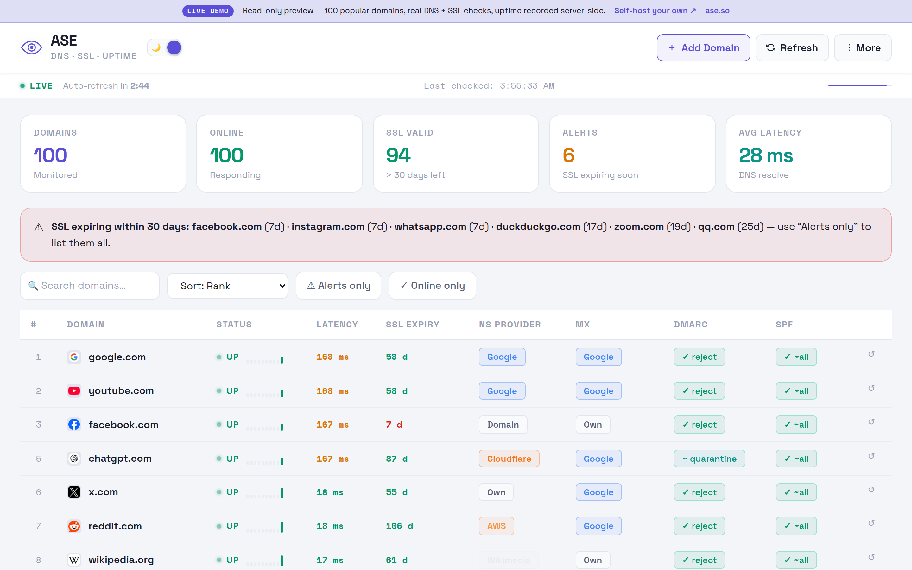
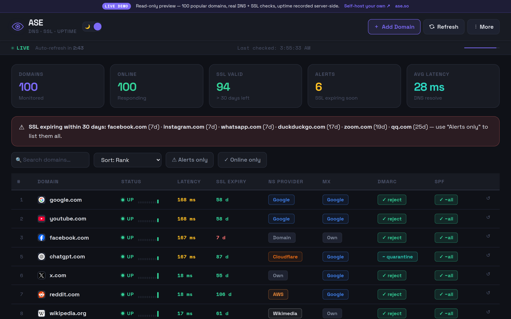
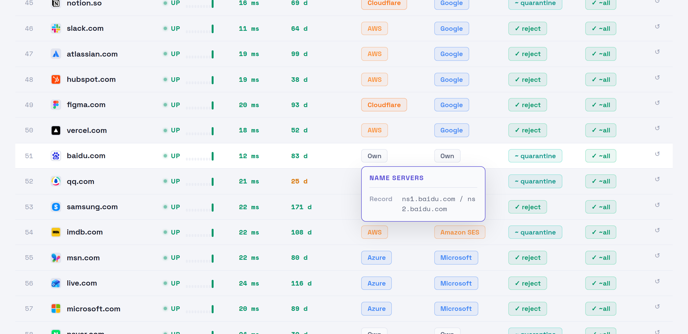
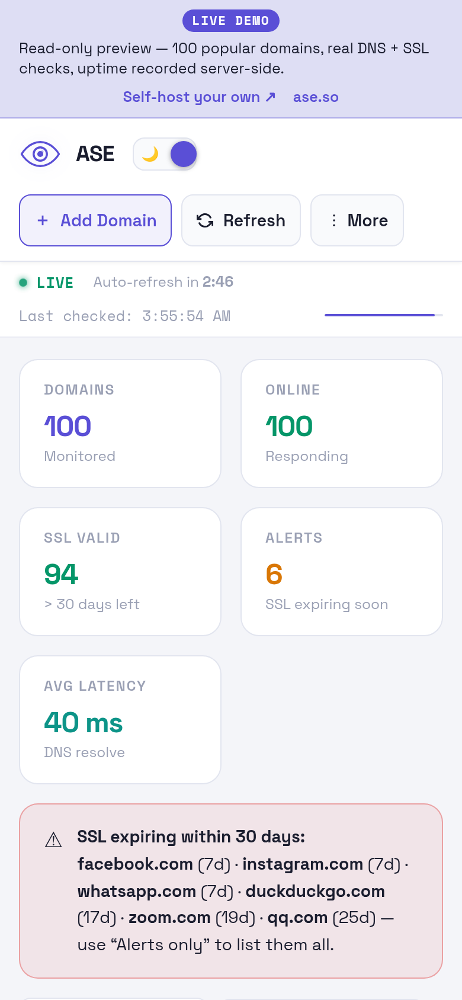
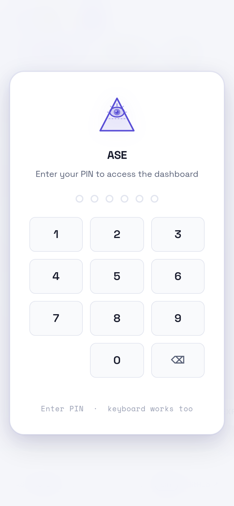
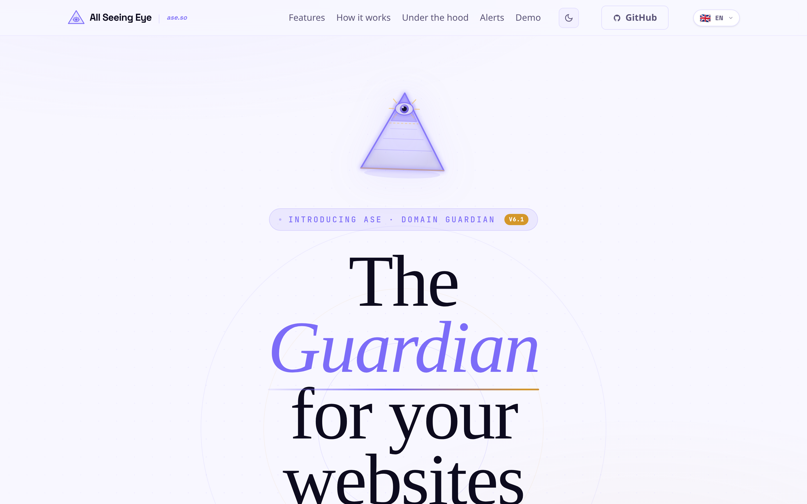

<p align="center">
  
</p>

<h1 align="center">All Seeing Eye (ASE)</h1>

<p align="center">
  <strong>A small, honest watchtower for your domains.</strong><br>
  DNS, SSL and email-security checks, uptime history and email alerts. Self-hosted, open source, no build step.
</p>

<p align="center">
  <a href="https://ase.live"><strong>Live demo</strong></a> &nbsp;·&nbsp;
  <a href="https://ase.so"><strong>Website</strong></a> &nbsp;·&nbsp;
  <a href="https://github.com/paulfxyz/ase/releases"><strong>Releases</strong></a> &nbsp;·&nbsp;
  <a href="./INSTALL.md"><strong>Install</strong></a> &nbsp;·&nbsp;
  <a href="./CHANGELOG.md"><strong>Changelog</strong></a>
</p>

<p align="center">
  <a href="https://github.com/paulfxyz/ase/releases"></a>
  <a href="./LICENSE"></a>
  <a href="https://github.com/paulfxyz/ase/stargazers"></a>
  <a href="https://github.com/paulfxyz/ase/commits/main"></a>
  <a href="https://github.com/paulfxyz/ase/issues"></a>
  
</p>

<p align="center">
  
  
  
  
  
  
  
  
</p>

<p align="center">
  <a href="https://ase.live"></a>
</p>

> **v6.1.0 is an audit release.** The code, this README and the landing page were re-checked against what the software really does, several bugs and security gaps were fixed, and a few claims were corrected. See [Audit Notes](#audit-notes-v610).

> **Built with AI, honestly.** ASE was vibe-coded with AI assistance and then audited, including an independent review of the authentication layer by a frontier model. It is a personal-scale tool, not a hardened enterprise product. Read the [Security Model](#security-model) before exposing it to the internet.

---

## At a glance

| | |
|---|---|
| **What it checks** | A record (DNS reachability), NS provider, MX provider, DMARC policy, SPF policy, real TLS certificate expiry and issuer, latency |
| **How it checks** | Live DNS-over-HTTPS from the browser, server-side TLS handshakes in PHP, a scheduled worker for 24/7 history |
| **What you get** | Sortable dashboard, expiry alerts, cumulative uptime history, email digests via Resend, CSV and JSON export |
| **What it needs** | Any Apache host with PHP 7.4+ (shared hosting is fine). No database, no npm, no build |
| **Where your data lives** | On your server. No accounts, no analytics |
| **Languages** | English, Français, Deutsch, Español, Português, Türkçe, 中文, 日本語, Русский, Italiano, हिन्दी (marketing site) |

## Screenshots

<table>
  <tr>
    <td width="50%"><br><sub><b>Dark mode.</b> Same data, easier on the eyes. The banner lists the six most urgent certificates.</sub></td>
    <td width="50%"><br><sub><b>Raw records on hover.</b> Every NS, MX, DMARC and SPF badge explains itself with the underlying DNS record.</sub></td>
  </tr>
  <tr>
    <td width="50%" align="center"><br><sub><b>Mobile first.</b> Stat cards and the table reflow for phones.</sub></td>
    <td width="50%" align="center"><br><sub><b>Sign-in.</b> A 6-digit PIN, verified on the server (bcrypt), with login throttling.</sub></td>
  </tr>
  <tr>
    <td colspan="2"><br><sub><b>The landing page</b> at <a href="https://ase.so">ase.so</a>, available in 11 languages.</sub></td>
  </tr>
</table>

Screenshots are taken from the [live demo](https://ase.live) with real DNS and TLS data.

## Quick start

```bash
git clone https://github.com/paulfxyz/ase.git
# upload the app files to your PHP host (see INSTALL.md for the exact list), then on the server:
php auth.php set-pin 482915                 # choose your own 6-digit PIN
echo "*/10 * * * * php $PWD/update-stats.php >/dev/null 2>&1" | crontab -   # optional: 24/7 history and alerts
```

Open your site, sign in, and edit `domains.list` or use **Add Domain**. The full guide, including SiteGround and cPanel notes, is in [INSTALL.md](./INSTALL.md).

## Keyboard shortcuts

| Key | Action |
|-----|--------|
| `/` | Focus the search box |
| `r` | Refresh all domains |
| `a` | Add a domain |
| `?` | How it works |
| `Esc` | Close dialogs |

## FAQ

**Is "UP" an HTTP check?** No. It means the domain's A record resolves. An HTTP status check is on the [roadmap](#roadmap).

**Does it phone home?** No. Your browser contacts Cloudflare DNS-over-HTTPS, Google Fonts and the Google favicon service; the server may fall back to crt.sh. Nothing is sent to the author.

**Can I run it without PHP?** The dashboard opens in a static mode with live DNS checks, but without sign-in, saved history, SSL handshakes or alerts.

**Is a 6-digit PIN enough?** For a private tool behind a rate limiter, it is a reasonable gate. It is not strong authentication; the [Security Model](#security-model) shows how to add HTTP Basic Auth.

**Why not UptimeRobot or Better Stack?** Those are excellent at HTTP uptime. ASE covers the DNS, certificate and mail-policy side in one table, and you host it yourself.

**Why does the demo show different SSL dates than yesterday?** Certificates are checked live (cached for 6 hours), so the numbers are real and change over time.

---


> This README is a deeply technical reference — it covers not just *how* to use ASE but *why* every architectural decision was made, every bug that was hit, and every lesson learned building it. If you're evaluating ASE for your own infrastructure or want to understand how a small monitoring dashboard can be built with plain HTML, JavaScript and PHP and no build tooling, read on. Sections that describe the early PIN design (SHA-256 in the browser) are kept as history; [Security Model](#security-model) describes the current design.

---

## Table of Contents

1. [The Origin Story](#the-origin-story)
2. [What ASE Does](#what-ase-does)
3. [Architecture Deep Dive](#architecture-deep-dive)
   - [DNS-over-HTTPS (DoH)](#dns-over-https-doh)
   - [Progressive Batch Scanning](#progressive-batch-scanning)
   - [SSL Certificate Checking — Three-Tier Strategy](#ssl-certificate-checking--three-tier-strategy)
   - [The SHA-256 Caching Bug](#the-sha-256-caching-bug)
   - [onclick vs addEventListener — The Sandboxed iframe Problem](#onclick-vs-addeventlistener--the-sandboxed-iframe-problem)
   - [CSS Stacking Context Escape — The Dropdown Bug](#css-stacking-context-escape--the-dropdown-bug)
   - [overflow:hidden + position:sticky Conflict — The Modal Close Bug](#overflowhidden--positionsticky-conflict--the-modal-close-bug)
   - [PIN Persistence — Three Tiers](#pin-persistence--three-tiers)
   - [Mobile PIN UX — Four Bugs](#mobile-pin-ux--four-bugs)
   - [Email Notifications — The Dual Cooldown System](#email-notifications--the-dual-cooldown-system)
   - [AES-256-GCM Key Encryption](#aes-256-gcm-key-encryption)
   - [Uptime Persistence Evolution](#uptime-persistence-evolution)
4. [Lessons Learned](#lessons-learned)
   - [Audit Notes (v6.1.0)](#audit-notes-v610)
5. [Building with AI](#building-with-ai)
6. [Tech Stack Decisions](#tech-stack-decisions)
7. [File-by-File Reference](#file-by-file-reference)
8. [Setup & Installation](#setup--installation)
9. [Notification System Setup](#notification-system-setup)
10. [Security Model](#security-model)
11. [Customisation Guide](#customisation-guide)
12. [Contributing Guide](#contributing-guide)
13. [Version History](#version-history)
14. [Roadmap](#roadmap)
15. [Author & Credits](#author--credits)

---

## The Origin Story

### The problem: 30+ domains, zero visibility

Managing more than thirty domains — a mix of production apps, side projects, client sites, and personal experiments — means living with a quiet, persistent anxiety: which one has a certificate about to expire? Which one's nameservers quietly stopped resolving after a registrar migration? Did that DMARC record survive the DNS zone transfer?

No existing tool solved this combination cleanly. Uptime monitors like UptimeRobot and Better Uptime check HTTP reachability, but they say nothing about DNS health, mail security posture, or SSL issuer. DMARC analysis tools check email infrastructure but ignore uptime. SSL monitoring dashboards don't query nameservers. To get the full picture of a domain's health, you had to cross-reference four different dashboards, none of which agreed on what mattered.

The obvious solution — a unified dashboard showing all five signals for every domain at once — didn't exist as a simple, self-hosted, no-build tool. Every existing option was either a SaaS with per-domain pricing, an enterprise product with a Kubernetes deployment guide, or a simple uptime check that missed the DNS and mail security story entirely.

### One session, one build

ASE started as a personal tool, built in a single focused session. The goal was modest: a table showing DNS resolution, SSL expiry, DMARC policy, and SPF record for every domain, refreshing automatically, accessible from a browser with no installation.

The first version was genuinely minimal — a few dozen lines of JavaScript, a hardcoded list of domains, five parallel `fetch()` calls to Cloudflare's DNS-over-HTTPS API, and a table that rendered the results. No PIN, no persistence, no notifications. Just the data, live in a browser tab.

What happened next was the familiar story of scope creep driven by real utility: the tool proved immediately useful, which revealed the things it was missing. PIN protection so it could be hosted publicly. Mobile support so it worked on a phone. Dark mode because it was going to live in a browser tab forever. Email notifications so downtime wasn't invisible. Cross-device uptime history so data survived closing the tab. Export to CSV so the data could be archived. Per-row refresh so a single domain could be re-checked without reloading everything.

Each feature revealed a new challenge. The PIN needed to be persistent across devices without a database. SSL expiry couldn't be checked from a browser (no TLS sockets in JavaScript). Notifications needed to be spam-resistant but still fire immediately when you manually hit Refresh. The dropdown menus escaped the wrong stacking contexts. The mobile PIN input auto-focused at the wrong time. Every fix introduced a new edge case.

Five major versions and dozens of point releases later, ASE was a real product.

### The decision to go open-source

The name "The All Seeing Eye" was always a working title — descriptive but slightly sinister, and too specific to the original personal use case. When the project reached a maturity level where it could be genuinely useful to other developers and system administrators, the decision to open-source it was easy.

The reasons:
- **The tool is useful.** There is a real gap in the market for a no-build, self-hosted infrastructure monitor that covers DNS + SSL + DMARC in a single view.
- **The bugs are instructive.** Every significant bug uncovered during development — the SHA-256 caching issue, the CSS stacking context trap, the PHP heredoc interpolation limitation — is a lesson that other developers will hit. Documenting them publicly is worth more than keeping them private.
- **Self-hosted tools deserve to be open.** If you're running this on your own server, you should be able to read every line of code. There are no analytics, no tracking, no phoning home.
- **AI assistance helped build it.** The collaboration model — a human providing product judgment and domain knowledge, an AI providing implementation speed and debugging breadth — produced something neither could have done as well alone. Making the result open-source felt like the right way to complete that story.

### The rename: The All Seeing Eye → Mercury → ASE

The rebrand to ASE happened as part of the v5.0.0 release that made the project fully public. ASE — the winged messenger god — is the right metaphor: fast, watchful, a conduit between you and the truth about your infrastructure. The name is distinctive, easy to remember, and doesn't carry the slightly ominous connotation of an all-seeing eye.

The repository was renamed from `the-all-seeing-eye` to `ase`. The landing page moved to `ase.so`. The demo went live at `ase.live` showing the top 100 most-visited domains on the internet, checked in real time.

---

## What ASE Does

ASE monitors any list of domains and reports on five signals simultaneously:

| Signal | What it tells you |
|--------|-------------------|
| **Uptime** | Is the domain resolving? How fast? (DNS round-trip latency in ms) |
| **SSL Expiry** | When does the certificate expire? Days remaining, colour-coded. Issuer detected (Let's Encrypt, DigiCert, etc.) |
| **Nameserver Provider** | Who is providing DNS? (Cloudflare, AWS Route53, Azure, Google, SiteGround, custom) |
| **Mail Provider** | Who handles email? (Google Workspace, Microsoft 365, ProtonMail, Amazon SES, Mimecast, etc.) |
| **DMARC/SPF** | Email authentication posture. `reject` (fully protected), `quarantine`, `none` (unenforced), `missing` (vulnerable) |

### Full feature list

**Monitoring**
- Live DNS checks via Cloudflare DoH — works in any browser, no backend required
- 5 parallel queries per domain: A, NS, MX, TXT, `_dmarc.TXT`
- Uptime percentage and sparkline chart per domain (hover to see history)
- Automatic SSL expiry warning at 30 days and 7 days
- DMARC/SPF health alerts with colour-coded severity

**Interface**
- Progressive scan — rows light up one batch at a time as results arrive
- Light/dark mode toggle (light by default, persisted server-side)
- Mobile-first design with native numeric PIN keyboard on touch devices
- Per-row refresh — re-scan any single domain with the ↺ icon
- Add domains live from the dashboard (no server restart needed)
- Search by domain name or category
- Sort by rank, SSL expiry, latency, status, or A→Z
- Filter to alerts-only or online-only
- Hover tooltips showing full DNS record values (NS hostnames, full MX records, raw DMARC/SPF strings)

**Landing Page (v5.1.0+)**
- 11-language i18n system — English · Français · Deutsch · Español · Português · Italiano · Türkçe · Русский · 中文 · 日本語 · हिंदी
- Language picker in nav: flag emoji + language code, smooth animated dropdown, ARIA-accessible
- Browser language auto-detection on first visit; preference persisted in `ase-lang` cookie
- Library-free i18n engine — no library, pure vanilla JS with `data-i18n` attribute convention
- `data-i18n-html` for elements containing inline HTML (subtitles with `<strong>`, steps with `<code>`)

**Automation**
- Auto-refresh every 3 minutes while a tab is open, with live countdown
- Server-side cron via `update-stats.php` for monitoring when no browser is open (CLI cron, or HTTP with a secret token)
- Export CSV and Export JSON of the current view
- Keyboard shortcuts: `/` search, `r` refresh, `a` add domain, `?` help, `Esc` close

**Persistence**
- Cumulative uptime history in `uptime.json` (checks, successes, first-seen, last-down)
- Settings in `ase_config.json` (theme, domains, notification config), served only to a signed-in session
- Read-only public demo mode (`demo.flag`) for showcases

**Notifications**
- Email alerts via Resend API (free tier: 100 emails/day)
- Downtime detection with UP/DOWN transition tracking
- Health digest email: SSL expiry warnings, DMARC/SPF issues
- Dual cooldown system: 5-minute cooldown for manual refresh, 24-hour for auto-refresh
- AES-256-GCM encrypted API key storage (never stored in plaintext)
- Server-side rate limiting: 10 emails per hour

**Security**
- Server-side PIN verification (bcrypt), signed HttpOnly SameSite=Strict session cookie, CSRF header on writes
- Login throttling: 5 failures / 15 min per IP and 30 / hour install-wide
- API key encrypted at rest (AES-256-GCM) with a random server-side secret; never sent back to the browser
- `.htaccess` blocks direct access to secrets and state files, forces HTTPS
- A 6-digit PIN is a convenience gate, not strong authentication; see [Security Model](#security-model)

---

## Audit Notes (v6.1.0)

Before publishing 6.1.0 the whole project was reviewed: the code was read end to end, the public claims were checked one by one, the server layer was tested with a local PHP server and a real browser, and the new authentication code was reviewed by an independent frontier model (OpenAI GPT-6.1 Sol Pro via OpenRouter). This section lists what that found. It is deliberately blunt.

### Bugs that existed in earlier releases

| Finding | Impact | Status |
|---|---|---|
| `update-stats.php` had a PHP parse error since v1.0 (`*/10` inside the file's own docblock closed the comment), plus escaped `\$` variables and `$domain…` read as one variable name | The server cron script **never ran**. "24/7 monitoring" and cron alerts did not work in any earlier release | Fixed and run locally end to end |
| `webhook.do` only works inside a real browser (it loads the dashboard in an iframe and runs JavaScript) | Pointing cron-job.org or UptimeRobot at it recorded nothing: those services do not execute JavaScript | Removed. Use `update-stats.php` instead |
| SSL expiry dates for the top-100 list were hardcoded snapshots from spring 2026 and the real TLS check was skipped for them | The demo showed `EXPIRED` for healthy certificates | Snapshots dropped, certificates are fetched live (cached 6 h server-side) |
| `domains.list` contained 8 duplicates | "100 domains" was really 92 unique | Replaced with 8 other popular domains and de-duplicated on load |
| Cron token committed to the public repository | Anyone could trigger the cron endpoint | Token removed; it now lives in an untracked `cron_token.key` |
| `config-write.php`, `notify.php`, `uptime-write.php` accepted any request without authentication, and `config-write.php` returned the PIN hash to anyone | The PIN gate was decorative: the hash (of a 6-digit PIN) could be read and cracked offline in milliseconds, and settings could be overwritten | PIN verified server-side (bcrypt), hash never leaves the server, all write endpoints need a session |
| DNS record text (TXT/NS/MX) and typed domain names were inserted with `innerHTML` unescaped | Stored XSS through a hostile DNS record | Escaped; domain names validated |
| `ssl-check.php` allowed any hostname, with `Access-Control-Allow-Origin: *` | Open TLS scanner, reachable internal hosts | Sign-in required, private/reserved addresses refused, connects to the validated IP, rate limited |
| CSV export did not guard against formula injection | `=cmd` cells in spreadsheet apps | Guarded |

### Claims that were not accurate and have been corrected

| Earlier claim | Reality |
|---|---|
| "One HTML file. Zero dependencies." | HTML + CSS + JS + several PHP files. No npm packages and no build step, but the browser contacts Cloudflare DNS-over-HTTPS, Google Fonts, the Google favicon service and (fallback) crt.sh |
| "Serverless" | The full feature set needs PHP. Without PHP the dashboard still runs in a static mode (no sign-in, no history) |
| "No cookies" | `ase_sid` (HttpOnly sign-in), `ase-lang`, `ase-theme`, and `ase_uptime` (local uptime fallback) |
| "Automate with cron-job.org via `webhook.do`" | Never worked. See above |
| "Uptime" | "UP" means the A record resolves. It is a DNS check, not an HTTP probe |
| "PIN protection" | In 6.0 and earlier the PIN was checked in the browser. In 6.1 it is checked on the server, but a 6-digit PIN is still a weak secret (see [Security Model](#security-model)) |
| "Your PIN is the encryption passphrase" (landing page) | The Resend key is encrypted with a random server secret (`notify_secret.key`), not with the PIN |
| NS / MX / DMARC / SPF of the bundled top-100 list are "live" | They are a snapshot; only A records and SSL are checked live for those rows. Domains you add get the full live scan, and `update-stats.php` checks everything live on the server |

### What the independent review added

The reviewer found, in the first draft of the new auth layer: demo mode derived from the `Host` header (spoofable), a default-PIN session with full access on a fresh install, a race that could revive old sessions after a PIN change, non-atomic and fail-open rate limiting, logout that did not revoke sessions, and plain-HTTP cookies. All were fixed before release: demo mode is now a server-side `demo.flag` file, a default-PIN session can only set a new PIN, config writes are serialised under a lock, attempts are reserved atomically and fail closed, logout rotates a session epoch, and `.htaccess` forces HTTPS.

---

## Architecture Deep Dive

This section explains every major architectural decision: what the approach is, why it was chosen, what alternatives were tried, and what went wrong.

### DNS-over-HTTPS (DoH)

#### Why browsers can't do raw DNS

JavaScript running in a browser has no access to raw DNS sockets. The browser's DNS resolution is entirely managed by the operating system and browser internals — JavaScript can't call `getaddrinfo()` or open a UDP socket to port 53. This means any browser-based DNS monitoring tool must find another path to DNS data.

The options are:
1. **Proxy through a server endpoint** — make an HTTP request to your own PHP/Node.js script which calls `dns_get_record()` on the server side
2. **DNS-over-HTTPS (DoH)** — make a standard HTTPS fetch to a DNS resolver that speaks HTTP (Cloudflare, Google, Quad9)
3. **Certificate transparency logs** — use crt.sh or other CT log APIs to get SSL data (doesn't cover DNS uptime)

ASE uses **Cloudflare's DoH API** (`cloudflare-dns.com/dns-query`) for all live DNS checks. The DoH endpoint accepts standard HTTPS requests and returns DNS answers as JSON:

```
GET https://cloudflare-dns.com/dns-query?name=example.com&type=A
Accept: application/dns-json
```

Response:
```json
{
  "Status": 0,
  "TC": false,
  "RD": true,
  "RA": true,
  "AD": false,
  "CD": false,
  "Question": [{ "name": "example.com.", "type": 1 }],
  "Answer": [{ "name": "example.com.", "type": 1, "TTL": 300, "data": "93.184.216.34" }]
}
```

**Why Cloudflare DoH specifically?**
- Zero CORS issues — Cloudflare's DoH endpoint returns `Access-Control-Allow-Origin: *`
- Extremely reliable (Cloudflare's 1.1.1.1 infrastructure)
- No API key required
- No rate limits for reasonable usage (ASE uses batching to stay within bounds)
- Returns authoritative answers fast (typically 20–80ms)
- JSON response format (the `application/dns-json` accept header) is clean to parse

**Why not Google's DoH (`8.8.8.8`)?** Google's DoH also works and is a viable alternative. Cloudflare was chosen because of its reputation for privacy (no query logging) and its generally faster response times in Europe and the Americas. ASE's `DOH` constant is a single-line change if you want to swap providers.

#### The 5-query-per-domain approach

Every domain check fires exactly five parallel DNS queries:

```javascript
var DOH = 'https://cloudflare-dns.com/dns-query?name=';

async function checkDomain(domain, fullScan) {
  // Query 1: A record — uptime + latency
  var t0 = Date.now();
  var aRecords = await dohQuery(domain, 'A');
  var ms = Date.now() - t0;
  var up = aRecords.length > 0;
  
  if (needFullScan) {
    // Queries 2-5: parallel
    var [nsRecs, mxRecs, txtRecs, dmarcRecs] = await Promise.all([
      dohQuery(domain, 'NS'),           // Query 2
      dohQuery(domain, 'MX'),           // Query 3
      dohQuery(domain, 'TXT'),          // Query 4: SPF lives here
      dohQuery('_dmarc.' + domain, 'TXT') // Query 5: DMARC
    ]);
  }
}
```

The A-record query is fired first, alone, because its response time is the latency measurement. Firing it in parallel with the other four would contaminate the latency reading (the Promise.all() time includes all four queries, not just the A record).

Queries 2–5 are fired in parallel because they're independent and there's no value in serialising them.

#### NS and MX provider detection

The raw NS records returned by DoH look like this:
```
ns-378.awsdns-47.com
ns-1012.awsdns-62.org
ns-1630.awsdns-11.co.uk
ns-1458.awsdns-54.org
```

These are machine-readable hostnames, not human-readable provider names. ASE maintains a lookup table of well-known patterns and applies them in order:

```javascript
function detectNSProvider(nsRecords, domain) {
  var hosts = nsRecords.map(r => r.data.toLowerCase().replace(/\.$/, ''));
  var all = hosts.join(' ');

  if (all.includes('awsdns'))       return 'AWS';
  if (all.includes('azure-dns'))    return 'Azure';
  if (all.includes('googledomains') || all.includes('ns-cloud')) return 'Google';
  if (all.includes('nsone.net'))    return 'NS1';
  if (all.includes('akam.net'))     return 'Akamai';
  if (all.includes('siteground'))   return 'SiteGround';
  // ... more providers

  // Self-NS detection: apple.com uses a.ns.apple.com → "Domain"
  var domainApex = apexDomain(domain);
  var allSelfHosted = hosts.every(h => apexDomain(h) === domainApex);
  if (allSelfHosted) return 'Domain';

  // Cloudflare check here — after self-NS — so cloudflare.com itself shows "Domain" not "Cloudflare"
  if (all.includes('cloudflare'))   return 'Cloudflare';

  // SLD fallback: extract second-level domain of first NS host
  var firstHost = hosts[0];
  var parts = firstHost.split('.');
  return capitalise(parts[parts.length - 2]);
}
```

**The "Own" label problem:** Early versions used `"Own"` as the label for self-hosted nameservers (domains that run their own nameservers, like `apple.com` using `a.ns.apple.com`). This was confusing — users saw `"Own"` for Apple, Facebook, and other major domains and couldn't tell if it meant "they own their NS infrastructure" or "I own this domain's NS."

The fix was to rename `"Own"` to `"Domain"` — a cleaner label meaning "this domain runs its own nameservers." The lookup table was also expanded from a simple string comparison to a full SLD-extraction fallback, so instead of showing `"Own"` for unknown providers, ASE now shows the registrar or DNS provider name derived from the NS hostname (e.g., `registrar-servers.com` → `"Registrar-servers"`).

---

### Progressive Batch Scanning

#### Why not fire all queries at once?

A naive implementation would fire all DNS queries simultaneously:

```javascript
// DON'T do this for 100 domains
await Promise.all(DOMAINS.map(d => checkDomain(d.domain)));
```

For 100 domains × 5 queries each = 500 simultaneous HTTPS requests. Problems:
1. **Browser connection limits** — browsers limit concurrent connections per host (typically 6). Cloudflare is one host. 500 requests would queue behind each other and the first results would arrive no faster than serialised ones.
2. **Looks like abuse** — 500 DNS queries arriving at a resolver in the same millisecond looks like a DoS attack or DNS amplification attempt.
3. **Memory spike** — 500 in-flight Promise objects, 500 response buffers simultaneously.
4. **No visual feedback** — the user sees nothing until all 500 queries complete.

#### The batch-of-5 + 300ms pause approach

```javascript
var DNS_BATCH_SIZE  = 5;    // domains per concurrent batch
var DNS_BATCH_DELAY = 300;  // ms between batches

async function checkAll() {
  for (var i = 0; i < DOMAINS.length; i += DNS_BATCH_SIZE) {
    var batch = DOMAINS.slice(i, i + DNS_BATCH_SIZE);
    
    // Check this batch in parallel
    await Promise.all(batch.map(d => checkDomain(d.domain)));
    
    // Un-dim rows immediately
    batch.forEach(d => setRowLoading(d.domain, false));
    
    // Re-render — user sees results for this batch
    renderTable();
    updateStats();
    
    // Small pause before next batch
    if (i + DNS_BATCH_SIZE < DOMAINS.length) {
      await sleep(DNS_BATCH_DELAY);
    }
  }
}
```

Benefits:
- **5 parallel queries per batch** → 5 × 5 = 25 simultaneous requests at peak (well within browser limits)
- **300ms pause between batches** → avoids burst flooding, looks deliberate not accidental
- **Re-render after each batch** → rows light up progressively, left to right, like a scanner sweeping the list
- **Total time for 100 domains**: approximately 6–8 seconds — fast enough to feel live, slow enough to be visible

#### Rate limiting and the `_checkRunning` flag

Two separate mechanisms prevent overlapping or too-frequent checks:

**`_checkRunning` flag** — set to `true` when `checkAll()` starts, reset when it finishes. If `triggerRefresh()` is called while a check is running, it polls every 200ms until the check finishes, then shows the result. This prevents the user from double-firing a check by clicking Refresh quickly.

**`CHECK_ALL_MIN_GAP`** — a minimum 5-second gap between full refresh runs. If Refresh is clicked before this gap has elapsed, the button shows a countdown (`⏳ 3s…`) and auto-fires when the gap expires. The user never needs to click again.

```javascript
var _checkRunning  = false;
var _lastCheckAll  = 0;
var CHECK_ALL_MIN_GAP = 5000; // ms

function triggerRefresh() {
  var now = Date.now();
  
  if (_checkRunning) {
    // Poll until check finishes
    var poll = setInterval(() => {
      if (!_checkRunning) { clearInterval(poll); setRefreshBtnNormal(); }
    }, 200);
    return;
  }
  
  var remaining = CHECK_ALL_MIN_GAP - (now - _lastCheckAll);
  if (remaining <= 0) {
    _manualRefresh = true;
    checkAll().then(setRefreshBtnNormal);
    return;
  }
  
  // Show countdown, then auto-fire
  var secs = Math.ceil(remaining / 1000);
  btn.innerHTML = '⏳ ' + secs + 's…';
  var ticker = setInterval(() => {
    secs--;
    if (secs > 0) {
      btn.innerHTML = '⏳ ' + secs + 's…';
    } else {
      clearInterval(ticker);
      _manualRefresh = true;
      checkAll().then(setRefreshBtnNormal);
    }
  }, 1000);
}
```

#### Progressive rendering and the 500ms minimum dim

Fast DNS responses (under 50ms) caused rows to flash so briefly the progressive scanning was invisible. The fix was a `MIN_ROW_LOADING_MS` floor:

```javascript
var MIN_ROW_LOADING_MS = 500;

function setRowLoading(domain, loading) {
  var row = document.querySelector('tr[data-domain="' + domain + '"]');
  
  if (loading) {
    _rowLoadingStart[domain] = Date.now();
    row.classList.add('is-checking');
  } else {
    var elapsed   = Date.now() - (_rowLoadingStart[domain] || 0);
    var remaining = Math.max(0, MIN_ROW_LOADING_MS - elapsed);
    
    setTimeout(() => {
      row.classList.remove('is-checking');
      row.classList.add('is-checking-done'); // triggers CSS fade-in transition
      setTimeout(() => row.classList.remove('is-checking-done'), 650);
    }, remaining);
  }
}
```

`is-checking-done` triggers a 600ms CSS fade-in transition, so rows that resolve quickly still animate in smoothly. The result is a visually satisfying progressive scan where every row has a clear "loading → resolved" transition regardless of how fast the DNS response arrived.

---

### SSL Certificate Checking — Three-Tier Strategy

#### Why browsers can't check SSL certificates

JavaScript in a browser cannot open raw TLS connections. `new WebSocket('wss://...')` and `fetch('https://...')` both use TLS, but the browser handles the handshake internally and the JavaScript code only sees the HTTP response — never the certificate. There is no `window.getCertificate()` API.

Certificate data is therefore inaccessible client-side unless you go through a workaround. ASE uses three, in priority order:

#### Tier 1: ssl-check.php (batch PHP)

The preferred path is a server-side PHP script that opens real TLS connections using `stream_socket_client()`:

```php
function check_ssl(string $domain, int $timeout = 8): array {
    $context = stream_context_create([
        'ssl' => [
            'capture_peer_cert' => true,
            'verify_peer'       => false, // want data even for expired certs
            'verify_peer_name'  => false,
            'SNI_enabled'       => true,
            'peer_name'         => $domain,
        ]
    ]);

    $stream = @stream_socket_client(
        'ssl://' . $domain . ':443',
        $errno, $errstr, $timeout,
        STREAM_CLIENT_CONNECT, $context
    );

    if (!$stream) {
        return ['domain' => $domain, 'error' => $errstr ?: 'Connection failed'];
    }

    $params = stream_context_get_params($stream);
    fclose($stream);
    
    $cert  = $params['options']['ssl']['peer_certificate'];
    $info  = openssl_x509_parse($cert);
    $validTo = $info['validTo_time_t'];
    $days    = (int) round(($validTo - time()) / 86400);

    return [
        'domain'         => $domain,
        'expiry'         => date('Y-m-d', $validTo),
        'issuer'         => detectIssuer($info),
        'days_remaining' => $days,
        'valid'          => $days > 0,
    ];
}
```

**Why `verify_peer: false`?** Because ASE wants to report on expired certificates — if `verify_peer` were `true`, PHP would refuse to connect to a server with an expired or misconfigured cert, and we'd get an error rather than the cert data we want to show.

**The batch endpoint** — early versions called `ssl-check.php?domain=example.com` for each domain individually. For 34 domains that was 34 separate browser→server HTTP requests. Version 2.0 added batch mode: `ssl-check.php?domains=d1.com,d2.com,...` returns a JSON array of all results in a single request.

```javascript
// In app.js — fetchAllSSLExpiry()
var CHUNK = 20; // stay within URL length limits
for (var i = 0; i < needed.length; i += CHUNK) {
    var chunk  = needed.slice(i, i + CHUNK);
    var params = chunk.map(encodeURIComponent).join(',');
    var phpRes = await fetch('./ssl-check.php?domains=' + params, {
        signal: AbortSignal.timeout(30000) // PHP processes sequentially
    });
    var results = await phpRes.json(); // array of { domain, expiry, issuer, days_remaining }
    // ...
}
```

The PHP server processes domains sequentially (one TLS connection at a time), which is fine — the browser just waits for the one response instead of managing 34 parallel connections.

#### Tier 2: crt.sh certificate transparency logs

If `ssl-check.php` returns a 404 (the user hasn't uploaded the PHP file, or they're on a static host), ASE falls back to crt.sh — the certificate transparency log search engine:

```javascript
var res = await fetch(
    'https://crt.sh/?q=' + encodeURIComponent(domain) + '&output=json&exclude=expired',
    { signal: AbortSignal.timeout(5000) }
);
var certs = await res.json();
var valid = certs
    .filter(c => c.not_after && new Date(c.not_after) > new Date())
    .sort((a, b) => new Date(b.not_after) - new Date(a.not_after));
var best = valid[0];
return { expiry: best.not_after.split('T')[0], issuer: detectIssuer(best.issuer_name) };
```

**Why crt.sh fails for private domains:** Certificate transparency only logs publicly-trusted certificates. A domain with a private CA certificate, or an internal corporate domain, won't appear in crt.sh logs at all. `ssl-check.php` works for these because it makes a direct TLS connection regardless of whether the cert is in any public log.

crt.sh is also occasionally slow (1–3 seconds) and sometimes returns 429 rate limit errors during peak times. It's a fallback, not a primary path.

#### Tier 3: domains.json seed from cron

The PHP cron script `update-stats.php` runs every 10 minutes and writes `domains.json` — a file containing SSL expiry data for all domains from server-side TLS checks. When the browser loads the dashboard, it immediately reads `domains.json` and pre-populates SSL expiry data before any DNS checks run:

```javascript
var jsonRes = await fetch('./domains.json', { cache: 'no-cache' });
var jsonData = await jsonRes.json();
// Apply pre-seeded SSL data to DOMAINS array
DOMAINS.forEach(d => {
    if (sslMap[d.domain] && !d.sslExpiry) {
        d.sslExpiry = sslMap[d.domain].expiry;
        d.sslIssuer = sslMap[d.domain].issuer;
        _sslChecked[d.domain] = true; // skip crt.sh for these
    }
});
```

The `_sslChecked` flag prevents double-querying: if a domain already has SSL data from `domains.json`, the live check skips it. This means SSL expiry data is available instantly on page load (from cron), and is also checked live in the browser (via `ssl-check.php` or crt.sh) for any domain that wasn't covered by the cron run.

---

### The SHA-256 Caching Bug

This is one of the more subtle bugs in the codebase. It corrupted PIN verification on every page load after the first use.

#### The symptom

PIN verification worked correctly the first time a user logged in. On subsequent attempts — including after correct PINs — verification would sometimes fail with a wrong hash. The SHA-256 hash of the same string was producing different results on the second call.

#### What happened

The original SHA-256 implementation cached its prime-number lookup tables as properties on the function object itself:

```javascript
// WRONG — broken version
function sha256(ascii) {
  if (!sha256.h) { // ← problem: this check fails correctly on first call
    sha256.h = []; // ← but stores state ON THE FUNCTION OBJECT
    sha256.k = [];
    for (var candidate = 2; sha256.h.length < 8 || sha256.k.length < 64; candidate++) {
      // ... generate primes, fill sha256.h and sha256.k
    }
  }
  
  // ... use sha256.h and sha256.k for the hash computation
  // The problem: sha256.h and sha256.k are MODIFIED during the hash computation
  // On the second call, they're not empty — they contain modified values from call 1
}
```

The intent was a performance optimisation: compute the prime tables once and cache them. The bug was that the hash computation algorithm itself modifies the `h` array in place during processing. On the first call, `sha256.h` starts correctly initialised. On the second call, `sha256.h` starts with whatever state the previous computation left it in.

SHA-256 is designed to be initialized fresh for every hash. The prime tables need to be reset to the fractional parts of square roots of the first 8 primes at the start of every computation. Caching and reusing them across calls violates the algorithm's contract.

#### The fix: stateless implementation

The corrected implementation declares `h` and `k` as local variables inside the function, recomputed fresh on every call:

```javascript
// CORRECT — stateless version
function sha256(ascii) {
  /* Stateless SHA-256 — recomputes primes each call, no caching bug */
  function rightRotate(value, amount) {
    return (value >>> amount) | (value << (32 - amount));
  }
  var maxWord = Math.pow(2, 32);
  var i, j, result = '', words = [];
  var asciiBitLength = ascii.length * 8;
  var hash = [], k = [], isComposite = {};
  
  // ← hash and k are LOCAL VARIABLES, recomputed fresh each call
  for (var candidate = 2; hash.length < 8 || k.length < 64; candidate++) {
    if (!isComposite[candidate]) {
      for (i = 0; i < 313; i += candidate) isComposite[i] = candidate;
      if (hash.length < 8) hash.push((Math.pow(candidate, .5)   * maxWord) | 0);
      if (k.length   < 64) k.push(   (Math.pow(candidate, 1/3) * maxWord) | 0);
    }
  }
  // ... rest of SHA-256 algorithm
}
```

The prime generation costs approximately 0.2ms. For a PIN verification that happens at most a few times per session, this cost is completely irrelevant. The "optimisation" that caused the bug saved literally nothing measurable.

**The lesson:** Never use function object properties (i.e., `myFn.propertyName = value`) as mutable state that an algorithm reads from and writes to. The function's own code may modify that state in ways that corrupt future calls. This is especially dangerous for cryptographic functions where correctness depends on a clean initial state.

---

### onclick vs addEventListener — The Sandboxed iframe Problem

#### The symptom

The PIN numpad buttons had been wired with `addEventListener('click', ...)` from a `DOMContentLoaded` callback — the standard, idiomatic approach for attaching JavaScript event listeners. This worked perfectly in direct browser tabs, but completely failed when the page was loaded inside a sandboxed iframe (such as a preview pane in AI assistance).

The buttons were visible, the CSS was applied correctly, but clicking a PIN button did nothing.

#### What happened

`DOMContentLoaded` fires when the parser finishes the HTML document. In a sandboxed iframe with restricted origin policies, this event fires but the JavaScript execution context may not have the same access to the DOM as it would in a top-level document. More specifically, in some sandboxed iframe configurations, `DOMContentLoaded` fires before the iframe's security policy is fully applied, and subsequent event listener attachments to elements that touch security-sensitive state (like a PIN form) are silently dropped.

The script was:

```javascript
// WRONG — fails in sandboxed iframes
document.addEventListener('DOMContentLoaded', function() {
    var buttons = document.querySelectorAll('.pin-btn');
    buttons.forEach(function(btn) {
        btn.addEventListener('click', function() {
            pinDigit(btn.dataset.digit);
        });
    });
});
```

The `addEventListener` calls executed without error, but the handlers were never invoked when the buttons were clicked.

#### The fix: inline onclick attributes

The solution was to move all event handling to inline `onclick` attributes directly in the HTML:

```html
<!-- In index.html — inline onclick, not addEventListener -->
<button class="pin-btn" onclick="pinDigit('1')">1</button>
<button class="pin-btn" onclick="pinDigit('2')">2</button>
<!-- etc. -->
```

Inline `onclick` attributes are parsed and associated with elements at the time the HTML is parsed, not at a separate event listener attachment step. They are evaluated in the document's global scope regardless of sandboxing restrictions. This bypasses the issue entirely.

**The broader principle:** Inline event handlers are universally available. `addEventListener` with `DOMContentLoaded` is a cleaner architectural pattern, but in environments where JavaScript execution is constrained (sandboxed iframes, CSP-restricted contexts, Perplexity previews, certain email clients), inline `onclick` is more reliable.

The comment in `app.js` documents this explicitly:
```javascript
/* onclick vs addEventListener: sandboxed iframes block DOMContentLoaded;
   all interactive elements use inline onclick/oninput/onchange instead */
```

#### The double-fire trap with touchstart + click

An earlier attempt to improve PIN responsiveness added a `touchstart` listener alongside `click`:

```javascript
// WRONG — double fires on touch devices
btn.addEventListener('touchstart', function() { pinDigit(digit); });
btn.addEventListener('click',      function() { pinDigit(digit); });
```

On touch devices, a finger tap generates *both* a `touchstart` event and, approximately 300ms later, a synthetic `click` event. The result: every PIN digit was registered twice. Entering `123456` produced `112233445566`.

The fix was to use `click` only — modern mobile browsers have reduced the synthetic click delay to near-zero, making `touchstart` unnecessary.

---

### CSS Stacking Context Escape — The Dropdown Bug

#### The symptom

The "More ⋮" dropdown menu in the header appeared to open, but was clipped by the header boundary — the dropdown content was hidden behind the main table content below.

#### The CSS stacking context trap

The sticky header was:
```css
.header {
    position: sticky;
    top: 0;
    z-index: 100;
}
```

`position: sticky` combined with `z-index` creates a **stacking context**. A stacking context is a self-contained 3D rendering layer in the browser's paint order. The critical rule: elements inside a stacking context can only stack relative to each other, not relative to elements outside the context.

So: the header has z-index 100, which means "paint this header above everything else in the root stacking context." But the dropdown inside the header gets a z-index that is relative only to other elements inside the header's stacking context. When the dropdown tried to appear below the header's boundary (visually overlapping the table), the browser clipped it because it was inside the header's layer.

The natural fix — `z-index: 9999` on the dropdown — had no effect. Increasing a z-index inside a stacking context doesn't help it escape the context.

#### The failed approach: backdrop div

One approach was to move the dropdown HTML outside the header, rendering it as an overlay at the root level. This worked for z-index positioning but introduced a new problem: the dropdown's trigger button was inside the header, and clicking the backdrop-level div required coordination between two separate parts of the DOM.

The backdrop approach also broke the `outside-click to close` behaviour: detecting "did the user click outside the dropdown" is normally done by checking whether a click event target is inside the dropdown element. With the dropdown and trigger split across different DOM subtrees, the hit-test logic became fragile.

#### The fix: position:fixed + getBoundingClientRect()

The real solution was to use `position: fixed` for the dropdown, positioned dynamically using `getBoundingClientRect()` of the trigger button:

```javascript
function openDropdown(triggerId) {
    var trigger = document.getElementById(triggerId);
    var rect    = trigger.getBoundingClientRect();
    
    var menu = document.getElementById('dropdown-menu');
    menu.style.position = 'fixed';
    menu.style.top  = (rect.bottom + 4) + 'px';
    menu.style.right = (window.innerWidth - rect.right) + 'px';
    menu.style.display = 'block';
    
    // Listen for outside clicks
    document.addEventListener('click', closeDropdownOnOutsideClick);
}
```

`position: fixed` is positioned relative to the viewport, not any ancestor. It completely escapes all stacking contexts — a fixed-positioned element with z-index 1000 will paint above everything on the page regardless of any ancestor stacking contexts. `getBoundingClientRect()` gives the trigger button's position in viewport coordinates, which is exactly the coordinate system `position: fixed` uses.

#### The click race condition when opening modals from dropdown items

A secondary bug emerged: clicking a dropdown item that opened a modal (like "Change PIN" or "Notifications") would fire two events in sequence:

1. The dropdown item's `onclick` handler ran → opened the modal
2. The document-level `closeDropdownOnOutsideClick` handler ran (because the modal's initial click was propagating to document) → immediately closed the dropdown AND sometimes closed the modal too

The fix was to consume the click event in the dropdown item handler:

```javascript
function openChangePinModal(event) {
    if (event) event.stopPropagation(); // prevent close-dropdown-on-outside-click
    closeDropdown();  // explicitly close dropdown first
    openModal('change-pin-overlay');
}
```

And to remove the document click listener as soon as any action was taken:

```javascript
function closeDropdownOnOutsideClick(e) {
    var menu = document.getElementById('dropdown-menu');
    if (!menu.contains(e.target)) {
        menu.style.display = 'none';
        document.removeEventListener('click', closeDropdownOnOutsideClick);
    }
}
```

---

### overflow:hidden + position:sticky Conflict — The Modal Close Bug

#### The symptom

In v2.3.0, the Help modal's close button stopped working. Clicking it visually appeared to respond, but the modal didn't close. Investigating revealed that the close button's click event was not being received.

After further investigation: clicking anywhere on the modal's body worked, but the close button (which was positioned at the top of the modal's sticky header) was unreachable.

#### The CSS rule that causes this

The fundamental CSS rule that caused this is a common pitfall:

> **`overflow: hidden` on any ancestor disables `position: sticky` on all descendants of that ancestor.**

More precisely: `overflow: hidden` creates a new block formatting context. `position: sticky` works by allowing an element to "stick" to the scroll container's viewport boundary. But `overflow: hidden` prevents the element from scrolling out of view — the sticky positioning has nothing to stick to — so the browser silently disables it.

The modal was structured as:

```css
/* WRONG — this combination breaks sticky child elements */
.modal-body {
    overflow-y: auto;    /* allows internal scrolling */
    overflow-x: hidden;  /* ← this also affects sticky! */
}

.modal-header {
    position: sticky;
    top: 0;
    z-index: 10;
}
```

The `overflow-x: hidden` on `.modal-body` disabled the sticky positioning of `.modal-header`. But the close button was rendered inside `.modal-header`, which was now no longer sticky-positioned but was still trying to be. The button was painted but was behind other elements in the paint order.

#### Multiple failed approaches

**Attempt 1:** Remove `overflow-x: hidden` from `.modal-body`. This caused horizontal overflow of the modal content to appear as scrollbars.

**Attempt 2:** Use `clip` instead of `overflow: hidden`. The `clip` property is deprecated and inconsistently supported.

**Attempt 3:** Use `overflow: clip` (the modern replacement for `clip`). This worked in Chrome but not in all target browsers.

**Attempt 4:** Restructure the modal so the close button was outside the scrollable area entirely. This required HTML structure changes.

#### The final fix: flex-column modal architecture

The solution that worked without any `overflow: hidden` on the close button's ancestor:

```css
/* CORRECT — flex column with no overflow:hidden on ancestors */
.modal-overlay {
    /* ... */
    display: flex;
    align-items: center;
    justify-content: center;
}

.modal {
    display: flex;
    flex-direction: column;
    max-height: 90vh;
    /* No overflow:hidden here */
}

.modal-header {
    flex-shrink: 0;  /* ← always visible, never scrolled away */
    /* No position:sticky needed — flex layout keeps it at top */
}

.modal-body {
    flex: 1;
    overflow-y: auto;  /* only this element scrolls */
    /* No overflow-x:hidden */
}

.modal-footer {
    flex-shrink: 0;  /* ← always visible at bottom */
}
```

By using `flex-shrink: 0` on the header and footer, they become non-scrollable and always visible — without needing `position: sticky` and without any `overflow: hidden` on their ancestors. The `overflow-y: auto` is only on the body element, which is the only thing that needs to scroll. No element's close button is trapped behind a stacking context issue.

**The lesson:** `position: sticky` + `overflow: hidden` on the same or ancestor element is a common footgun. The CSS specification notes this but it's not obvious in practice. The fix is to design modals with flex-column architecture from the start, making `position: sticky` for header/footer unnecessary.

---

### PIN Persistence — Three Tiers

> **Superseded in v6.1.0.** Earlier releases verified the PIN in the browser and kept its SHA-256 hash in `ase_config.json`, a JavaScript-readable cookie and `index.html`. That design could not protect anything: `config-write.php` handed the hash to any visitor, and a 6-digit PIN falls to an offline brute force instantly. It was replaced by server-side verification (`auth.php`), bcrypt storage and a signed HttpOnly session cookie. The history below (cookies, HTTP PUT attempts, timing bugs) is kept because the lessons still apply, but none of it is in the current code.

#### The challenge that started it: cross-device PIN without a database

The PIN has to survive switching browsers, incognito sessions and device changes, and ASE has no database. The 6.1 answer is the same flat-file idea with the right trust boundary: the hash lives only in `ase_config.json` on the server, and the browser only ever holds an opaque signed session cookie.

#### Why HTTP PUT to index.html never worked

Shared hosts do not accept PUT to static files, so any approach that tried to write the PIN into `index.html` silently failed. That is why a PHP endpoint writes the config.

### Mobile PIN UX — Four Bugs

Mobile PIN entry had four distinct bugs, all present simultaneously in v3.x before being fixed in v4.1.0.

#### Bug 1: Duplicate dots

The PIN entry UI uses both custom dot indicators (`.pin-dot` elements) and an `<input type="number">` field. The input had a placeholder attribute with bullet characters:

```html
<!-- WRONG -->
<input type="number" placeholder="••••••" id="pin-input">
```

On mobile, both the custom dots and the input's placeholder were visible simultaneously, showing 12 dots when 6 were expected. The fix was to remove the input placeholder entirely — the custom dots are the visual feedback, the input is just an invisible capture mechanism.

#### Bug 2: Input not centred

The PIN input had a fixed width without `margin: auto`:

```css
/* WRONG */
#pin-input {
    width: 200px;
    /* no margin: auto */
}
```

On narrow mobile screens (320–375px wide), the input was left-aligned, making the PIN entry feel broken and unprofessional. The fix:

```css
/* CORRECT */
#pin-input {
    width: 200px;
    margin: 0 auto;
    display: block;
}
```

#### Bug 3: Auto-focus never fired

On mobile, the numeric PIN keyboard should appear automatically when the PIN overlay becomes visible. The original code used `element.focus()` directly, but it never triggered the keyboard.

The first diagnosis attempt was a MutationObserver watching the overlay's `style` attribute for a change from `display: none` to `display: flex`:

```javascript
// WRONG — watches style attribute, but overlay is controlled by CSS class, not inline style
var observer = new MutationObserver(function() {
    if (overlay.style.display === 'flex') {
        pinInput.focus();
    }
});
observer.observe(overlay, { attributes: true, attributeFilter: ['style'] });
```

This never fired. The reason: the overlay's visibility was controlled by a CSS class (`.pin-overlay.visible { display: flex; }`) — not by setting `overlay.style.display` directly. The `style` attribute never changed. The MutationObserver was watching the wrong thing.

The second attempt added `display` to the MutationObserver's filter and also watched class changes:

```javascript
// ALSO WRONG — element.style.display === "" even when the class makes it visible
observer.observe(overlay, { attributes: true, attributeFilter: ['style', 'class'] });
if (overlay.style.display === '') {
    // This is always true — '' means "no inline style set", not "not displayed"
}
```

Checking `overlay.style.display` reads the element's **inline** style. When visibility is controlled by a CSS class (`.pin-overlay { display: none } .pin-overlay.visible { display: flex }`), the inline `style.display` is always `""` (empty string). The element can be visually hidden or visible while `element.style.display === ""` stays constant.

The correct way to check whether an element is visible is `getComputedStyle(overlay).display !== 'none'`.

#### The fix: requestAnimationFrame + setTimeout(120ms)

The definitive fix used a different approach entirely — call focus at the right moment in the rendering cycle:

```javascript
function showPinOverlay() {
    overlay.classList.add('visible');
    
    // requestAnimationFrame: waits for the browser to process the class change
    // and schedule the next paint. At this point the element is in the DOM
    // but the paint hasn't happened yet.
    requestAnimationFrame(function() {
        // setTimeout(120ms): on iOS, focus() before the keyboard animation
        // completes causes the keyboard to appear and immediately dismiss.
        // 120ms gives the system time to recognize the focused element
        // and commit to showing the keyboard.
        setTimeout(function() {
            var input = document.getElementById('pin-input');
            if (input) input.focus();
        }, 120);
    });
}
```

Why `requestAnimationFrame`? It fires after the browser has processed the class change but before the next paint — the element is now in its "visible" state in the DOM, making `focus()` meaningful.

Why `setTimeout(120ms)`? On iOS specifically, calling `focus()` immediately after an element becomes visible causes the keyboard to appear and immediately close. The system needs approximately 100–150ms to "commit" to displaying the keyboard. 120ms was empirically determined to work reliably across iPhone models.

#### Bug 4: Change PIN modal — same issues, same fix

The Change PIN modal had identical bugs: duplicate dots, missing centring, and auto-focus that never fired. The same `requestAnimationFrame + setTimeout(120ms)` pattern was applied there too.

---

### Email Notifications — The Dual Cooldown System

This is the most complex part of ASE's codebase. Getting email notifications right required solving several interacting problems.

#### Problem 1: The first implementation never sent emails on Refresh

Early notification code tracked the last send time in a simple in-memory variable:

```javascript
// WRONG — in-memory only
var _notifyLastSent = {};  // { domain: timestamp }

function sendAlert(domain) {
    var now = Date.now();
    var last = _notifyLastSent[domain] || 0;
    
    if (now - last < 24 * 60 * 60 * 1000) {
        return; // 24h cooldown
    }
    
    _notifyLastSent[domain] = now;
    // ... send email
}
```

Problems:
1. `_notifyLastSent` resets to `{}` on every page load. Every page refresh looked like the first one — all cooldowns were gone — which could cause alert storms.
2. But the 24h cooldown was applied to **manual** Refresh clicks too. If you manually hit Refresh an hour after getting an alert, the 24h cooldown blocked the email even though a human was explicitly asking for a status update.

#### Problem 2: The real problem — conflating manual and automatic checks

The root issue was treating manual and automatic refresh as the same event. They have fundamentally different semantics:

- **Auto-refresh every 3 minutes**: You don't want an email every 3 minutes if a domain is down. A 24-hour cooldown makes sense to prevent inbox flooding.
- **Manual Refresh button**: The user is explicitly checking status. They *want* to know immediately if something is wrong. A 5-minute cooldown (to prevent accidental double-notifications) makes sense, but a 24-hour cooldown defeats the purpose.

#### The dual cooldown system

The fix was two separate cooldown tables with different durations:

```javascript
var NOTIFY_COOLDOWN_MANUAL = 5  * 60 * 1000;  //  5 minutes
var NOTIFY_COOLDOWN_AUTO   = 24 * 60 * 60 * 1000; // 24 hours

var _notifyLastManual = {}; // domain → timestamp of last manual-triggered send
var _notifyLastAuto   = {}; // domain → timestamp of last auto-triggered send
```

And a `_manualRefresh` flag to tell `checkAll()` which cooldown to apply:

```javascript
function triggerRefresh() {
    _manualRefresh = true;  // set BEFORE checkAll()
    checkAll().then(setRefreshBtnNormal);
}

async function checkAll() {
    // ... run checks ...
    var wasManual = _manualRefresh;
    _manualRefresh = false; // consume the flag
    sendHealthReport(wasManual);
}

function sendHealthReport(isManual) {
    var cooldown = isManual ? NOTIFY_COOLDOWN_MANUAL : NOTIFY_COOLDOWN_AUTO;
    var lastSent = isManual ? _notifyLastManual : _notifyLastAuto;
    
    // Check cooldown per-domain
    var issues = DOMAINS.filter(d => hasHealthIssue(d));
    issues.forEach(issue => {
        var last = lastSent[issue.domain] || 0;
        if (Date.now() - last > cooldown) {
            sendDigest(issue);
            lastSent[issue.domain] = Date.now();
        }
    });
}
```

The `_manualRefresh` flag is set by `triggerRefresh()` (the user-facing button) but NOT by the auto-refresh timer. This ensures the flag accurately reflects user intent.

#### Persisting cooldown timestamps across page loads

The in-memory-only bug required persisting timestamps to `ase_config.json`:

```javascript
function _notifySaveState() {
    saveConfig({
        notify_last_manual: _notifyLastManual,
        notify_last_auto:   _notifyLastAuto
    });
}

function _notifyLoadState(cfg) {
    _notifyLastManual = cfg.notify_last_manual || {};
    _notifyLastAuto   = cfg.notify_last_auto   || {};
}
```

`_notifyLoadState()` is called inside `loadConfig()` on every page load, restoring the cooldown state before any checks run.

#### The cron gap: update-stats.php detected alerts but never sent them

`update-stats.php` runs DNS and SSL checks server-side every 10 minutes. Early versions wrote the results to `domains.stats` but had no notification capability — the cron could detect a DMARC issue but had no way to email the user about it.

The fix was to add a notification call at the end of the cron script, calling `notify.php` directly via `file_get_contents()` with the same JSON API that the browser uses:

```php
// In update-stats.php — send notifications after checks
foreach ($alerts as $alert) {
    $payload = json_encode([
        'action'     => 'digest',
        'issues'     => $issuesList,
        'total_domains' => count($domains),
        'domains_down'  => $domainsDown
    ]);
    
    $ctx = stream_context_create(['http' => [
        'method'  => 'POST',
        'header'  => 'Content-Type: application/json',
        'content' => $payload
    ]]);
    @file_get_contents('http://localhost/' . $scriptDir . '/notify.php', false, $ctx);
}
```

#### The PHP parse errors in notify.php

`notify.php` went through three parse error bugs during development:

**Bug 1: Arrow functions require PHP 7.4+**

```php
// WRONG — fn() syntax requires PHP 7.4+
$criticals = array_filter($issues, fn($i) => $i['severity'] === 'critical');

// CORRECT — traditional anonymous function, works PHP 5.3+
$criticals = array_filter($issues, function($i) { return $i['severity'] === 'critical'; });
```

Shared hosting (SiteGround, Bluehost) often runs PHP 7.3 or earlier. Arrow functions (`fn() =>`) are a PHP 7.4 feature. The fix was to replace all arrow functions with traditional anonymous functions.

**Bug 2: Ternary expressions inside heredoc**

PHP heredoc syntax (`<<<HTML ... HTML`) only interpolates simple variables (`$var`) and object/array access (`$obj->prop`, `$arr['key']`). It does not interpolate expressions, function calls, or ternary operators:

```php
// WRONG — ternary inside heredoc
$html = <<<HTML
<td>{$spf ? h($spf) : 'missing'}</td>
HTML;
// PHP parse error: unexpected '?'
```

The fix was to pre-compute all display values into variables before the heredoc:

```php
// CORRECT — resolve all values before heredoc
$spfStr = $spfVal ? h($spfVal) : '<span style="color:#dc2626">missing</span>';

$html = <<<HTML
<td>{$spfStr}</td>
HTML;
```

This pattern is now documented explicitly in the `notify.php` source comments.

**Bug 3: Escaped quotes in double-quoted strings**

Building HTML strings with PHP's string concatenation sometimes required escaping quote characters that conflicted with PHP string delimiters:

```php
// WRONG — unescaped inner quotes cause parse error
$alertsHtml .= "<div style="background:{$bg}">"; // parse error

// CORRECT
$alertsHtml .= "<div style=\"background:{$bg}\">"; // escaped
// or use single-quoted string for the outer
$alertsHtml .= '<div style="background:' . $bg . '">';
```

The migration to building all HTML row-by-row (outside heredocs, using string concatenation) eliminated this class of bug.

---

### AES-256-GCM Key Encryption

ASE stores a Resend API key (starts with `re_...`) to send email notifications. Storing this key in plaintext in `ase_config.json` would mean anyone who gains read access to the server's files gets your Resend API key.

#### The encryption flow

When the user saves their API key in the Notifications modal:

```
Browser                    config-write.php              Filesystem
───────                    ────────────────              ──────────
key: "re_abcdef..."   ──HTTPS POST──▶   encrypt(key, secret)
                                        │
                                        ├──write──▶  ase_config.json
                                        │            (ciphertext only, never plaintext)
                                        │
                                        └──write──▶  notify_secret.key
                                                     (the secret, chmod 0600)
```

When `notify.php` needs to send an email:

```
notify_secret.key  ──read──▶  secret (in PHP memory only)
ase_config.json    ──read──▶  encrypted key (ciphertext)
                              decrypt(ciphertext, secret) = "re_abcdef..."
                              POST to api.resend.com with key
```

The API key only exists in plaintext in PHP memory for the duration of one `notify.php` execution. It is never written to disk unencrypted.

#### AES-256-GCM: authenticated encryption

AES-256-GCM (Advanced Encryption Standard, 256-bit key, Galois/Counter Mode) is used because GCM is **authenticated encryption** — it provides not just confidentiality (nobody can read the key) but also integrity (nobody can tamper with the ciphertext and have it decrypt to a valid key).

The ciphertext format is: `base64(IV || TAG || CIPHERTEXT)`:

```php
function encryptApiKey(string $plaintext, string $secret): string {
    $key    = hash('sha256', $secret, true);  // derive 256-bit key from hex secret
    $iv     = random_bytes(12);               // 12-byte random IV (standard for GCM)
    $tag    = '';                             // GCM generates a 16-byte auth tag
    
    $cipher = openssl_encrypt(
        $plaintext, 'aes-256-gcm', $key,
        OPENSSL_RAW_DATA, $iv, $tag, '', 16
    );
    
    return base64_encode($iv . $tag . $cipher);
}
```

Decryption:
```php
function decryptApiKey(string $encoded, string $secret) {
    $raw    = base64_decode($encoded);
    $key    = hash('sha256', $secret, true);
    $iv     = substr($raw, 0, 12);   // first 12 bytes
    $tag    = substr($raw, 12, 16);  // next 16 bytes
    $cipher = substr($raw, 28);      // rest is ciphertext
    
    return openssl_decrypt($cipher, 'aes-256-gcm', $key, OPENSSL_RAW_DATA, $iv, $tag);
    // Returns false if tag doesn't match — tamper detection
}
```

The 16-byte authentication tag means: if any byte of the ciphertext is changed (e.g., by an attacker who has access to `ase_config.json` but not `notify_secret.key`), `openssl_decrypt()` returns `false` and the email is not sent. Bit-flipping attacks on encrypted keys are not possible.

The secret is auto-generated on first use and stored with `chmod 0600` (readable only by the process owner, not group or world):

```php
function getOrCreateSecret() {
    if (file_exists(SECRET_FILE)) return trim(file_get_contents(SECRET_FILE));
    $secret = bin2hex(random_bytes(32)); // 256-bit random secret
    file_put_contents(SECRET_FILE, $secret);
    chmod(SECRET_FILE, 0600);
    return $secret;
}
```

If `notify_secret.key` is deleted, the encrypted API key becomes unreadable. The user must re-enter the key in the dashboard. This is by design — it means there's no recovery path that could expose the key.

---

### Uptime Persistence Evolution

#### v1: In-memory

The first version tracked uptime entirely in memory:

```javascript
var domainState = {};
// populated during each check, lost on page reload
```

Fine for a single-session tool. Completely useless as a real monitor — every page load started from scratch with zero history.

#### v2: Cookie

The second approach serialised uptime data to a browser cookie:

```javascript
document.cookie = 'ase_uptime=' + encodeURIComponent(JSON.stringify(_uptimeData))
    + '; max-age=31536000; path=/; SameSite=Lax';
```

Problems:
- **4KB cookie limit** — `ase_uptime` exceeded 4KB for more than ~40 domains, causing the cookie to be silently truncated and data to be lost
- **Lost in incognito** — private browsing sessions don't share cookies with regular sessions
- **Device-local** — checking from a different device or browser showed zero history
- **Shared hosting issues** — cookies set on `yourdomain.com/uptime/` have path restrictions

#### v3.1: Server-side via uptime-write.php + uptime.json

The current approach: uptime data lives in `uptime.json` on the server, written by `uptime-write.php`. All devices and browsers share one authoritative record:

```javascript
// Save: POST only changed domains (delta approach)
async function uptimeSave() {
    if (Object.keys(_uptimeDelta).length > 0) {
        var deltas = _uptimeDelta;
        _uptimeDelta = {}; // clear delta before async ops
        
        Object.keys(deltas).forEach(async domain => {
            var d = deltas[domain];
            await fetch('./uptime-write.php', {
                method: 'POST',
                headers: { 'Content-Type': 'application/json' },
                body: JSON.stringify({
                    domain:    domain,
                    checks:    d.deltaChecks,
                    ups:       d.deltaUps,
                    firstSeen: _uptimeData[domain]?.firstSeen || Date.now(),
                    lastDown:  _uptimeData[domain]?.lastDown  || null
                })
            });
        });
    }
    
    // Cookie always written as fallback
    document.cookie = 'ase_uptime=' + encodeURIComponent(JSON.stringify(_uptimeData))
        + '; max-age=31536000; path=/; SameSite=Lax';
}
```

**The delta approach** — only domains that were checked in this cycle have their data POSTed to the server. A page monitoring 100 domains doesn't POST 100 records after every check — only the ones that actually changed.

On the server side, `uptime-write.php` reads the existing `uptime.json`, merges the incoming delta (accumulating the check counts), and writes back:

```php
// In uptime-write.php
$existing = json_decode(file_get_contents('uptime.json'), true) ?: [];
$domain = $posted['domain'];

if (!isset($existing[$domain])) {
    $existing[$domain] = ['checks' => 0, 'ups' => 0, 'firstSeen' => $posted['firstSeen'], 'lastDown' => null];
}

$existing[$domain]['checks'] += intval($posted['checks']);
$existing[$domain]['ups']    += intval($posted['ups']);
if ($posted['lastDown']) $existing[$domain]['lastDown'] = $posted['lastDown'];

// Atomic write: temp file + rename (prevents corruption on concurrent writes)
$tmp = 'uptime.json.tmp';
file_put_contents($tmp, json_encode($existing, JSON_PRETTY_PRINT));
rename($tmp, 'uptime.json');
```

The atomic write (temp file + `rename()`) prevents data corruption if two devices happen to send uptime data at the same time. On POSIX filesystems, `rename()` is an atomic operation — `uptime.json` either has the old content or the new content, never a partial write.

---

## Lessons Learned

These are the 15 most important lessons from building ASE — specific enough to be actionable for any JavaScript/PHP developer.

### Lesson 1: Never use function object properties as mutable state

If a function writes to `myFn.cache = someValue` and that value is read back on subsequent calls as part of an algorithm, you've created hidden mutable state that violates the function's contract. This is especially dangerous for cryptographic functions.

**The rule:** Functions should be stateless by default. If caching is needed, use a separate module-level variable with an explicit name (e.g., `var sha256Cache = {};`), not `sha256.cache = {};`. The explicit variable makes the statefulness visible and reviewable.

### Lesson 2: DOMContentLoaded doesn't fire reliably in sandboxed iframes

In standard browser contexts, `DOMContentLoaded` is reliable. In sandboxed iframes (cross-origin, `sandbox` attribute, Perplexity preview, certain embedding contexts), event listener attachment after `DOMContentLoaded` may silently fail.

**The rule:** For elements that must work in all embedding contexts, use inline `onclick` attributes rather than `addEventListener`. It's less architecturally elegant but universally reliable.

### Lesson 3: overflow:hidden on any ancestor disables position:sticky on all descendants

This is documented in the CSS specification but routinely surprises developers. The "fix" of adding higher z-index values never works — the fundamental issue is that `overflow: hidden` changes how scroll containers work, which removes the sticky element's scroll context.

**The rule:** Never put `overflow: hidden` or `overflow: auto` on a container that has `position: sticky` descendants unless you want those sticky elements to silently stop working. Use flex layouts with `flex-shrink: 0` instead of sticky for modal header/footer elements.

### Lesson 4: position:sticky inside a stacking context is capped by that context's z-index

`position: sticky` creates a stacking context. Elements inside that stacking context have z-index values relative only to other elements inside it. A dropdown that tries to visually appear "outside" the sticky header by getting a high z-index will be clipped by the header's stacking context boundary.

**The rule:** For elements that need to appear outside their parent's visual boundaries (dropdown menus, tooltips, popovers), use `position: fixed` positioned with `getBoundingClientRect()`. `position: fixed` is viewport-relative and escapes all stacking contexts.

### Lesson 5: HTTP PUT to index.html almost never works on shared hosting

Standard shared hosting (SiteGround, Bluehost, DreamHost, HostGator) runs Apache without WebDAV enabled. HTTP PUT to a `.html` file returns 405. Even enabling WebDAV requires server-level config changes that shared hosting won't allow.

**The rule:** Never design a feature that requires HTTP PUT to a static file. Use a PHP endpoint (like `config-write.php`) that reads a separate writable JSON file.

### Lesson 6: `element.style.display === ""` for CSS-class-controlled visibility

When an element's visibility is controlled by a CSS class (`display: none` in the default rule, `display: flex` when a class is added), the element's inline `style.display` property is `""` (empty string) in **both** the hidden and visible states.

```javascript
// WRONG — always shows "" regardless of visual state
console.log(overlay.style.display); // "" even when visually shown

// CORRECT — reads the computed (effective) style
console.log(getComputedStyle(overlay).display); // "none" or "flex"
```

**The rule:** Use `getComputedStyle(el).display` to check visibility, not `el.style.display`, unless you're explicitly setting inline styles.

### Lesson 7: MutationObserver on the style attribute won't fire for CSS-class-controlled visibility

Extending Lesson 6: if you use `MutationObserver` to watch an element's `style` attribute for display changes, and visibility is controlled by a CSS class (not inline style), the observer fires only when someone changes inline styles — it never fires for class changes.

**The rule:** Watch `attributeFilter: ['class']` if you're reacting to class-based visibility changes. Better: use a direct function call from the code that adds the class.

### Lesson 8: requestAnimationFrame is required before focus() on iOS

On iOS Safari, calling `focus()` on an input immediately after making it visible (by changing a class or display style) does nothing or causes the keyboard to briefly appear and then dismiss. The browser hasn't yet processed the DOM change.

**The rule:** To programmatically focus an input on iOS:
1. Make the element visible (add class, change display)
2. `requestAnimationFrame()` — waits for the browser to schedule the next paint
3. `setTimeout(120)` — gives iOS time to recognize the focusable element
4. `focus()`

### Lesson 9: fn() arrow functions require PHP 7.4+ — check your server PHP version first

Arrow functions (`fn($x) => $x * 2`) were introduced in PHP 7.4. Shared hosting often runs PHP 7.3 or earlier. If you're writing PHP that will run on shared hosting, use traditional anonymous functions (`function($x) { return $x * 2; }`) unless you know the server's PHP version.

**The rule:** Check `php --version` before writing modern PHP syntax. Use PHPCompatibility tools or test on the oldest PHP version your hosting supports.

### Lesson 10: Heredoc interpolation only supports `{$simpleVar}`, not expressions or function calls

PHP heredoc (`<<<HTML ... HTML`) interpolates `$variable`, `{$object->property}`, and `{$array['key']}`. It does not interpolate:
- Ternary expressions: `{$x ? 'a' : 'b'}` → parse error
- Function calls: `{h($var)}` → parse error
- Method calls: `{$obj->method()}` → parse error

**The rule:** Pre-compute all display values into named variables before the heredoc. This makes the code more readable anyway — complex interpolation logic doesn't belong inside a heredoc.

### Lesson 11: AES-256-GCM requires storing the IV and tag alongside the ciphertext

AES-GCM uses a randomly-generated Initialization Vector (IV) for each encryption. Without the IV, decryption is impossible. The authentication tag must also be stored for decryption verification.

**The rule:** Always store the IV and GCM tag with the ciphertext. ASE's format: `base64(IV[12] || TAG[16] || CIPHERTEXT)`. Never reuse an IV for the same key — generate a fresh `random_bytes(12)` for every encryption.

### Lesson 12: A 24h cooldown on auto-refresh makes sense; on manual Refresh it's terrible UX

Notification cooldowns exist to prevent inbox flooding. But the semantics of "auto-check every 3 minutes" and "user clicked Refresh" are different. A 24-hour cooldown on auto-refresh prevents spamming. The same 24-hour cooldown on a manual Refresh makes the notification system feel broken.

**The rule:** Apply different cooldowns to automated and user-initiated events. User-initiated events should have short cooldowns (minutes), automated events should have long cooldowns (hours/days).

### Lesson 13: CSS stacking contexts are created by many more properties than just z-index

Stacking contexts are created by:
- `position: fixed` or `sticky` or `relative` or `absolute` + any `z-index` other than `auto`
- `transform` (any non-`none` value)
- `filter` (any non-`none` value)
- `opacity` less than 1
- `isolation: isolate`
- `will-change` (for some properties)
- `contain` (with layout, paint, or strict values)

**The rule:** Be aware that adding `transform`, `filter`, or `opacity < 1` to a container will create a stacking context that clips the z-index of all descendants. This is a common way to accidentally break dropdowns and tooltips.

### Lesson 14: The backdrop div for outside-click detection fails in stacking contexts

A common pattern for dropdowns is to render a transparent full-screen backdrop div, then close the dropdown when the backdrop is clicked. This fails when the dropdown's trigger is inside a stacking context — the backdrop is at the root level but the dropdown appears to be inside the stacking context, causing z-index conflicts.

**The rule:** Use `document.addEventListener('click', closeOnOutsideClick)` with `menu.contains(e.target)` checking instead of a backdrop div. Remove the listener when the menu closes.

### Lesson 15: Progressive rendering beats "loading…" spinners — users perceive it as faster

A single "Loading…" indicator that disappears when all 100 domains are checked makes the app feel slow. Progressive rendering — where each batch of 5 domains appears as it completes — makes the same total time feel substantially faster because the user sees immediate results and constant progress.

**The rule:** Design for incremental display. Show partial results as soon as they're available. Users' perception of speed is driven by time-to-first-result more than total time.

---

## Building with AI

ASE was built in collaboration with AI assistance — an AI assistant capable of writing, debugging, and reasoning about code.

### How the collaboration worked

The development model was straightforward: a human (the author) provided product judgment, design decisions, and domain knowledge; AI provided implementation speed, debugging breadth, and documentation thoroughness.

The session structure was conversational and iterative. A typical exchange:

1. **Human:** "The dropdown menu is being clipped by the header. I've tried increasing z-index but it doesn't help."
2. **Computer:** "This is a CSS stacking context issue. Your sticky header creates a new stacking context, and z-index values inside it don't affect elements outside. The fix is to use `position: fixed` with `getBoundingClientRect()`. Here's the implementation: ..."
3. **Human:** "That works, but now clicking a dropdown item that opens a modal closes the modal immediately."
4. **Computer:** "That's a click propagation race — the dropdown item's click bubbles up to the document listener and triggers `closeOnOutsideClick` before the modal opens. Add `event.stopPropagation()` to the item handlers."

This cycle — describe symptom → get root cause analysis → get implementation → test → report new symptom — is the core of AI-assisted development. The human brings context (what the user experience feels like, what the design intent is), the AI brings technical depth (knowledge of CSS painting models, PHP version compatibility matrices, cryptographic API details).

### The context summary approach

Single development sessions for a large project hit context window limits. The pattern used to maintain continuity across sessions: at the end of each session, ask the AI to produce a "context summary" — a structured document containing:
- The current state of the codebase (what each file does)
- Active bugs being investigated
- Decisions made and their rationale
- Known issues deferred to future sessions

This context summary was pasted at the start of the next session. Combined with the actual code files in the workspace, it allowed new sessions to pick up exactly where the previous one ended.

### What the AI was good at

- **Architecture reasoning:** Explaining *why* `position: fixed` escapes stacking contexts, not just that it does
- **Cross-domain knowledge:** Knowing that `overflow: hidden` disables `position: sticky`, that `fn()` requires PHP 7.4, that GCM authentication tags must be stored alongside ciphertext
- **Debugging:** Given "the second SHA-256 call produces wrong results," diagnosing "the prime tables are being cached on the function object and modified in place"
- **Documentation:** Writing comprehensive inline comments, this README, the INSTALL.md guide
- **Edge cases:** Raising the iOS focus() timing issue before it was encountered in testing

### What required human judgment

- **Design decisions:** Whether the app should be light-first or dark-first; whether the PIN should be 4 or 6 digits; where controls belong in the layout
- **Feature prioritisation:** Which of twenty possible features should be in v5.0.0 vs deferred
- **UX feel:** The progressive scan visual effect; the 500ms minimum row loading time; the font sizes and spacing
- **Business decisions:** Open-source vs closed, MIT vs GPL, Resend vs alternatives
- **Naming:** "ASE," the brand identity, the copy

### The iterative improvement loop

The codebase went through 39 commits between v1.0 and v5.0. Almost every commit was an improvement to something that already existed — not a rewrite, but a refinement. The iteration cycle:

1. Feature implemented (often correctly on first pass for algorithmic logic)
2. Tested in browser (often revealed UX issues not visible in code review)
3. Edge cases hit (mobile, different screen sizes, incognito, static hosts)
4. Fixed with AI assistance (usually correct on second attempt, always on third)
5. Documented (comments, CHANGELOG, eventually this README)

The ratio of "first attempt correct" to "needed iteration" was roughly 70/30 for JavaScript logic, 60/40 for CSS (CSS edge cases are harder to predict from a description), and 80/20 for PHP.

### Total session duration

v1.0 through v5.0 was built in approximately one marathon day of development. Not calendar time — one focused session, with breaks for testing, from an initial sketch to a live public product with a landing page, demo, GitHub repository, and this README.

The AI's contribution to documentation alone would have taken multiple days of human writing time. The architecture reasoning (catching the stacking context bug, diagnosing the SHA-256 issue, designing the dual cooldown system) would have required hours of research time that was compressed into seconds.

---

## Tech Stack Decisions

### Why vanilla JavaScript (no React/Vue/Svelte)

The philosophy: **use the minimum technology that solves the problem.**

ASE's UI has one view (the dashboard table), one data model (DOMAINS array + domainState object), and one render function (`renderTable()`). The entire UI state fits comfortably in fewer than 200 lines of pure DOM manipulation code. React's virtual DOM diffing, Vue's reactivity system, Svelte's compiled components — all of these solve problems that ASE doesn't have.

More practically: adding a framework would require a build step. No npm, no webpack, no `node_modules`, no `package.json`, no `.babelrc`, no CI pipeline for building. The entire app is deployed by copying three files to a server. This is a feature.

Vanilla JS in 2026 is also genuinely capable. `async/await`, `fetch`, `AbortSignal.timeout()`, `Promise.all()`, template literals (avoided for iframe compatibility, but available), `getComputedStyle()` — modern browser JS has everything ASE needs. The one missing browser API (TLS socket access) is solved by the PHP backend, not by a framework.

### Why PHP for server endpoints (vs Node.js, Python)

PHP was the obvious choice for shared hosting compatibility. The target deployment environment — SiteGround, Bluehost, DreamHost, any cPanel-based host — almost universally has PHP available, configured, and running. The same is not true for Node.js (which usually requires a VPS or a Node-specific hosting environment) or Python (available on some hosts but often without the necessary packages installed).

The PHP endpoints (`ssl-check.php`, `config-write.php`, `notify.php`, `uptime-write.php`, `update-stats.php`) use only built-in PHP functions:
- `stream_socket_client()` — TLS connections
- `openssl_x509_parse()` — certificate parsing
- `dns_get_record()` — server-side DNS queries (cron only)
- `openssl_encrypt/decrypt()` — AES-256-GCM
- `file_get_contents()`, `file_put_contents()` — file I/O
- `json_encode()`, `json_decode()` — JSON

No Composer, no packages, no `vendor/` directory. The PHP files work on PHP 5.6+ (with the exception of `fn()` arrow functions, which have been removed in favour of traditional anonymous functions for compatibility).

### Why Cloudflare DoH (vs other providers)

Alternatives considered:
- **Google DoH (`8.8.8.8`)** — works, no CORS issues, but Google has a larger surveillance surface area
- **Quad9 (`dns.quad9.net`)** — privacy-focused, works well, but slightly slower response times in testing
- **Own DNS resolver** — would require a server-side PHP endpoint, defeating the browser-native approach
- **DNS.SB (`doh.dns.sb`)** — less known, possible reliability concerns

Cloudflare's `1.1.1.1` was chosen because:
1. No query logging policy (publicly audited by KPMG)
2. Consistently fastest DoH response times (20–40ms typical)
3. Global Anycast infrastructure — works fast from Europe, US, Asia
4. `Access-Control-Allow-Origin: *` header — no CORS friction
5. Free, no API key, well-documented JSON format
6. Extremely reliable (Cloudflare has had one major outage in the history of `1.1.1.1`)

The `DOH` constant is a one-line change if you need to switch providers.

### Why Resend (vs SendGrid, Mailgun, AWS SES)

**SendGrid** — generous free tier but complex API, legacy infrastructure, owned by Twilio (which adds some corporate unpredictability to free tier longevity).

**Mailgun** — historically had a very generous free tier that was dramatically reduced over the years. Not reliable for free-tier use.

**AWS SES** — requires an AWS account, IAM setup, sandbox exit approval, a VPC or external access configuration. Too much complexity for a self-hosted tool that should just work.

**Resend** — developer-focused, generous free tier (100 emails/day, 3,000/month), clean API design, fast delivery, and genuine enthusiasm for the developer community. The API is simple enough to be called from `file_get_contents()` in PHP with a single `stream_context_create()` call — no library needed.

The integration in ASE: one PHP function, ~20 lines:

```php
function sendViaResend(string $apiKey, string $from, string $to, string $subject, string $html): array {
    $payload = json_encode(['from' => $from, 'to' => [$to], 'subject' => $subject, 'html' => $html]);
    $ctx = stream_context_create(['http' => [
        'method'  => 'POST',
        'header'  => "Content-Type: application/json\r\nAuthorization: Bearer {$apiKey}",
        'content' => $payload,
        'timeout' => 10,
        'ignore_errors' => true
    ]]);
    $response = @file_get_contents('https://api.resend.com/emails', false, $ctx);
    // ... parse HTTP status, return result
}
```

### Why MIT license

ASE is built on top of open web standards, uses Cloudflare's public DoH API, and was built with AI assistance. The appropriate license for a tool that the community should be able to use freely is MIT.

MIT allows:
- Commercial use (hosting it for clients, including it in a product)
- Modification (forking, adapting for your own needs)
- Distribution (bundling it with other software)
- Private use (using it without publishing changes)

The only requirement is preserving the copyright notice.

GPL was considered (requires derivative works to also be open-source) but rejected — the goal is maximum utility and adoption, not copyleft enforcement.

---

## File-by-File Reference

| File | Purpose |
|------|---------|
| `index.html` | Application shell: PIN pad, dashboard, modals. Sets demo-mode styling before first paint |
| `app.css` / `app.js` | All styles and all client logic (sign-in flow, DNS checks, table, notifications, uptime, export, shortcuts) |
| `landing.html` + `i18n.js` | Marketing site (served as `index.html` on ase.so) and its 11-language strings |
| `auth.php` | Server-side sign-in, sign-out, set/change PIN. Rate limited. CLI: `php auth.php set-pin 482915` |
| `_ase.php` | Shared helpers: sessions, rate limiter, cron token, demo flag, SSRF guard. Not reachable over HTTP |
| `config-write.php` | Settings read/write (signed-in only; never returns the PIN hash or API-key ciphertext) |
| `uptime-write.php` | Cumulative uptime history (signed-in or cron token) |
| `ssl-check.php` | Real TLS handshake, batch mode, 6 h cache, sign-in required, public addresses only |
| `notify.php` | Email digests via Resend; AES-256-GCM key decrypt; 10 emails/hour limit |
| `update-stats.php` | The scheduled worker: DNS + SSL checks, writes `domains.stats`, `domains.json`, `uptime.json`, sends alerts. CLI or token |
| `domains.list` | Watchlist, one domain per line |
| `.htaccess` | HTTPS, method filter, security headers, blocks secrets and state files (Apache 2.2 and 2.4) |
| Runtime files (created, never committed) | `ase_config.json`, `auth_secret.key`, `auth_rate.json`, `notify_secret.key`, `notify_rate.json`, `cron_token.key` (you create it), `uptime.json`, `ssl_cache.json`, `domains.stats`, `domains.json`, `demo.flag` (demo only) |

### index.html

The HTML shell contains:
- `<meta>` tags, viewport, title
- Link to `app.css`
- The PIN overlay (`.pin-overlay`) with numpad
- The main dashboard (header, stat cards, table)
- All modal overlays (Add Domain, Help, Change PIN, Notifications, Scheduled checks)
- Script tag loading `app.js` at end of body
- Inline bootstrap: `loadConfig().then(() => { ... initDashboard ... })`

The HTML intentionally uses inline `onclick` attributes rather than `addEventListener` throughout, for sandboxed iframe compatibility (see Architecture section).

### app.js

Organised into 12 numbered sections with large banner comments:

1. **(removed)** — the browser-side SHA-256 is gone; PINs are verified by `auth.php`
2. **Server state** — `loadConfig()`, `saveConfig()`, `aseFetch()` (CSRF header, expired-session handling)
3. **PIN gate** — `pinDigit()`, `pinCheck()` (calls `auth.php`), `pinUpdateDots()`, keyboard handler
4. **Theme switch** — light/dark toggle with server persistence
5. **Domain data** — `BUILTIN` array (top 100), `TOOLTIPS` map
6. **Live state** — `DOMAINS[]`, `domainState{}`, `pendingQueue[]`, rate limiter vars
7. **Uptime persistence** — `uptimeLoad()`, `uptimeSave()`, `uptimeRecord()`
8. **Helper functions** — `daysUntil()`, `sslClass()`, `latClass()`, `sparklineHTML()`
9. **Render table** — `renderTable()`, `updateStats()`, `toggleFilter()`
10. **Live DNS checks** — `dohQuery()`, `detectNSProvider()`, `detectMXProvider()`, `checkDomain()`, `checkAll()`
11. **SSL checking** — `fetchSSLExpiry()`, `fetchAllSSLExpiry()`
12. **Auto-refresh** — `triggerRefresh()`, `refreshRow()`, countdown timer
13. **Domains.list loader** — `loadDomainList()`
14. **Add domain modal** — `openAddModal()`, `confirmAddDomains()`
15. **Notifications** — `sendHealthReport()`, `notifyDowntime()`, cooldown system
16. **Export** — `exportCSV()`, `exportJSON()`
17. **(removed)** — the browser-based webhook mode; scheduling is done by `update-stats.php`
18. **Bootstrap** — `initDashboard()`, startup sequence

### app.css

Variables-first design with CSS custom properties:
```css
:root {
    --accent: #7c3aed;
    --green:  #10b981;
    --yellow: #f59e0b;
    --red:    #ef4444;
    /* ... */
}
[data-theme="dark"] {
    --bg: #0f172a;
    --surface: #1e293b;
    /* ... */
}
```

The single `data-theme` attribute on `<html>` controls the entire theme. All components reference CSS variables, making light/dark switching a one-attribute change with zero JavaScript DOM manipulation beyond the attribute toggle.

---

## Setup & Installation

### Requirements

- An Apache host with PHP 7.4+ (SiteGround, cPanel and most shared hosts qualify). `.htaccess` support is needed for the file protection and HTTPS redirect
- Write permission in the install directory (ASE creates its own state files)
- Optional: a [Resend](https://resend.com) API key for email alerts

Without PHP the dashboard still opens in a **static mode**: live DNS checks and the table work, but there is no sign-in, saved history, SSL handshake or alerting.

### Step 1 — Download

```bash
git clone https://github.com/paulfxyz/ase.git
```

Or download the ZIP from [GitHub Releases](https://github.com/paulfxyz/ase/releases).

### Step 2 — Upload

Upload the contents of the repository (except `landing.html`, `i18n.js`, `avatar.jpg` and the docs, which belong to the marketing site) to a directory on your host. Keep `.htaccess`. If you do not use Apache, replicate its rules: deny access to `ase_config.json`, `*.key`, `auth_rate.json`, `notify_rate.json`, `ssl_cache.json`, `uptime.json`, `cron_notify_sent.json`, `.ase_config.lock` and `_ase.php`.

### Step 3 — Choose your PIN

Option 1 (recommended): from a shell on the server

```bash
php auth.php set-pin 482915      # any 6 digits except 123456 or 111111-style repeats
```

Option 2: open the site, sign in with the factory PIN `123456`, and ASE immediately asks for your own. Until you do, that session can do nothing else. On a freshly uploaded, publicly reachable site, do this straight away (or use option 1), because anyone who knows the default PIN could otherwise claim the install.

Forgotten PIN: delete `ase_config.json` over FTP (this also resets your saved settings), or run the CLI command above.
Locked out by the rate limiter: delete `auth_rate.json`.

### Step 4 — Your domains

Edit `domains.list`, one domain per line, `#` for comments. You can also add domains from the dashboard.

### Step 5 — Scheduled checks (optional but recommended)

A browser tab only checks while it is open. For round-the-clock history and alert emails, run `update-stats.php` on a schedule. It performs the same DNS, SSL and mail-policy checks, accumulates `uptime.json`, writes `domains.stats` and `domains.json`, and sends the alert digest if notifications are configured.

#### Option A: server cron (best; no token needed)

cPanel / SiteGround: Site Tools, Devops, Cron Jobs, command:

```
php /home/USER/public_html/PATH/update-stats.php >/dev/null 2>&1
```

Every 10 minutes is plenty. SSL certificates are cached for 6 hours.

#### Option B: external scheduler over HTTP (cron-job.org, GitHub Actions, UptimeRobot)

1. Create `cron_token.key` in the install directory containing a random string of 24+ characters (e.g. `openssl rand -hex 24`).
2. Call `https://yourdomain.com/update-stats.php` with the header `X-ASE-Token: <that string>`. A `?token=` query parameter also works but ends up in access logs, so prefer the header.
3. Without `cron_token.key` the HTTP route is closed (403). The token is never stored in the repository.

### Step 6 — Open the dashboard

Visit your site, sign in, and you are done. Use **More → Scheduled checks** in the app for these same instructions.

### Public demo mode

Create an empty file named `demo.flag` next to `index.html` and the install becomes a read-only showcase: no sign-in, all write endpoints return 403, `ssl-check.php` only answers for domains on the watchlist, uptime is recorded by your server cron only. This is how [ase.live](https://ase.live) runs. Demo mode is decided by the file, not the hostname, so it cannot be switched on by a spoofed `Host` header.

---

## Notification System Setup

ASE sends email alerts via the [Resend](https://resend.com) API. The free tier (100 emails/day, no credit card) is more than sufficient for personal infrastructure monitoring.

### What each alert contains

Every notification is a full health digest, not just "domain is down":

| Field | Example |
|-------|---------|
| Status | 🔴 DOWN / ✅ RECOVERED |
| Latency | 42ms |
| SSL Expiry | 2026-08-15 (143d) — green |
| DMARC | `reject` — green |
| SPF | `~all` — shown |
| Nameserver | Cloudflare |
| Mail Provider | Google |
| Health Alerts | ⚠️ SSL Expiring Soon, 🚨 DMARC Missing |

### When alerts fire

| Event | Alert? | Cooldown |
|-------|--------|----------|
| Domain goes DOWN | ✅ Yes | — |
| Domain recovers (UP) | ✅ Yes | — |
| Manual Refresh detects issue | ✅ Yes | 5 minutes |
| Auto-refresh detects issue | ✅ Yes | 24 hours |
| SSL expiring ≤30 days | ✅ Yes | 24 hours |
| DMARC missing/none | ✅ Yes | 24 hours |
| SPF missing | ✅ Yes | 24 hours |
| Same domain still DOWN next check | ❌ No | — |
| Test button | ✅ Always | Ignores rate limit |

### Step 1 — Get a Resend API key

1. Sign up at [resend.com](https://resend.com) (free, no credit card)
2. Verify your sending domain under **Domains** (e.g. `alerts.yourdomain.com`)
3. Go to **API Keys** → **Create API Key** → copy the key (starts with `re_`)

### Step 2 — Configure in dashboard

1. Log in → **More ⋮** → **Notifications**
2. Enable the **Email alerts** toggle
3. Paste the Resend API key (will be encrypted before saving)
4. Enter **From email** (must match your verified Resend domain)
5. Enter **To email** (where alerts are delivered)
6. Click **Save**
7. Click **Send Test** — verify delivery

### How the API key is secured

```
Browser          config-write.php         Filesystem
───────          ────────────────         ──────────
re_abcdef...  ──HTTPS POST──▶  AES-256-GCM encrypt(key, secret)
                               ├──write──▶  ase_config.json
                               │            (ciphertext only)
                               └──write──▶  notify_secret.key
                                            (secret, chmod 0600)

notify.php  ──read──▶  notify_secret.key
notify.php  ──read──▶  ase_config.json
notify.php  ──decrypt──▶  re_abcdef... (in PHP memory only)
notify.php  ──POST──▶  api.resend.com
```

The raw API key never appears on disk. `notify_secret.key` is `chmod 0600` and blocked by `.htaccess`. `ase_config.json` contains only the ciphertext.

### Troubleshooting notifications

| Symptom | Cause | Fix |
|---------|-------|-----|
| Test email never arrives | Wrong API key or unverified From domain | Check Resend dashboard → Logs |
| "Failed to decrypt API key" | `notify_secret.key` deleted or corrupted | Re-enter API key in Notifications modal |
| "Notifications disabled" | Toggle is off | Enable toggle → Save |
| Alerts stop after a while | Rate limit (10 emails/hour) | Normal — resets after 1 hour |
| Emails go to spam | From domain not verified | Verify domain DNS in Resend dashboard |
| Manual Refresh doesn't trigger email | Issue already alerted in last 5 minutes | 5-minute manual cooldown — wait and retry |
| No cron alerts | `update-stats.php` cron not running | Check `cron.log` |

---

## Security Model

ASE is a single-user dashboard for a small number of domains. It is built to be reasonably safe when exposed to the internet, but its only credential is a 6-digit PIN, and you should treat it accordingly.

### What ASE does

| Threat | Protection |
|--------|------------|
| Reading or overwriting settings without signing in | Every write endpoint requires a valid session; `config-write.php` returns only the theme to signed-out visitors |
| PIN hash leaking to the browser | The hash (bcrypt) never leaves the server |
| Guessing the PIN | 5 failures / 15 min per IP and 30 / hour install-wide, reserved before the PIN is checked, fail-closed if the limiter file is unusable, 0.6 s delay per failure |
| Stolen / copied session | Cookie is HMAC-signed, HttpOnly, SameSite=Strict (Secure on HTTPS); changing the PIN or signing out rotates a server-side epoch that invalidates every issued cookie |
| Cross-site request forgery | State-changing calls need a custom `X-ASE: 1` header, which browsers cannot send cross-origin without a CORS preflight (ASE never grants one) |
| Fresh install with the public default PIN | A default-PIN session can do exactly one thing: set a new PIN |
| Race between a PIN change and a settings write | Config read-modify-write is serialised under a lock file |
| API key exposure from a leaked config | AES-256-GCM with a random secret in `notify_secret.key` (0600). Ciphertext is never sent to the browser. If an attacker can read your whole install directory they get both, which is unavoidable on flat-file hosting |
| Direct access to secrets and state files | `.htaccess` denies them (Apache 2.2 and 2.4 syntax) |
| SSRF through `ssl-check.php` | Sign-in required, hostname syntax check, every resolved address must be public, the connection goes to the validated IP, per-IP rate limit and time budget |
| XSS through hostile DNS records or domain names | Output escaped, domain names validated on input and load |
| Spoofed demo mode | Demo is a server-side file flag, not a header |
| Email flooding | 10 emails/hour, 24 h auto cooldown, 5 min manual cooldown |

### What ASE does not do

- **Strong authentication.** A 6-digit PIN has about 20 bits of entropy; bcrypt does not change that. Rate limiting makes online guessing slow (about 480 tries a day per IP, 720 install-wide), not impossible for a patient, distributed attacker. For anything sensitive, add HTTP Basic Auth or an IP allow-list at the web server (snippet below).
- **Lockout resistance.** The install-wide cap means someone can deliberately burn the budget and temporarily block your sign-in. Delete `auth_rate.json` to reset it, or sign in from an existing session.
- **Protect against a compromised server.** Anyone with filesystem access reads everything.
- **Multi-user access control.** One PIN, one config, one notification address.
- **HTTP-level uptime.** "UP" means the A record resolves.
- **Hide your watchlist.** `domains.list`, `domains.json` and `domains.stats` are served as static files so the dashboard can read them. Do not put secrets in domain names.
- **Run anywhere.** Behind a reverse proxy, make sure `X-Forwarded-Proto` is set only by your proxy, because it decides whether the session cookie is marked Secure.

### Recommended for public deployments

```apache
# .htaccess — HTTP Basic Auth in front of everything (create the file with: htpasswd -c ~/.htpasswd you)
AuthType Basic
AuthName "ASE — restricted"
AuthUserFile /home/YOURUSER/.htpasswd
Require valid-user
```

If you use Basic Auth, exempt `update-stats.php` (or use the CLI cron) so the scheduler can reach it.

### Reporting a vulnerability

Open a private security advisory on the GitHub repository.

---

## Customisation Guide

### Changing the default domain list

Edit `domains.list` — plain text, one domain per line, `#` for comments. The file is fetched on every page load (with `cache: 'no-cache'`), so changes take effect immediately on reload.

The `BUILTIN` constant in `app.js` is the fallback used when `domains.list` is absent or empty. To change the built-in list for a deployment, edit the `BUILTIN` array directly.

### Changing the colour scheme

All colours are CSS custom properties in `app.css`:

```css
:root {
    --accent:    #7c3aed;   /* purple — primary brand colour */
    --accent-lt: #ede9fe;   /* light purple — for badges/highlights */
    --green:     #10b981;   /* up/healthy indicators */
    --yellow:    #f59e0b;   /* warning indicators */
    --red:       #ef4444;   /* down/critical indicators */
}
```

To change the brand colour from purple to blue: `--accent: #2563eb; --accent-lt: #dbeafe;`

### Changing the auto-refresh interval

```javascript
// In app.js — default is 180 seconds (3 minutes)
var refreshTimer = 180;
```

### Changing the PIN

See [Step 4 in Setup](#step-4--change-the-default-pin).

### Changing the DoH provider

```javascript
// In app.js
var DOH = 'https://cloudflare-dns.com/dns-query?name=';
// Change to Google:
var DOH = 'https://dns.google/resolve?name=';
// Change to Quad9:
var DOH = 'https://dns.quad9.net/dns-query?name=';
```

### Adding custom NS/MX provider detection

The `detectNSProvider()` and `detectMXProvider()` functions in `app.js` have lookup tables at the top. To add a provider:

```javascript
// In detectNSProvider()
if (all.includes('yourdnsprovider'))  return 'YourProvider';

// In detectMXProvider()
if (all.includes('yourmailserver'))   return 'YourMailProvider';
```

### Adding custom badge colours

NS and MX badges are styled by CSS classes in `app.css`. To add a new provider badge colour:

```css
/* In app.css */
.ns-yourprovider { background: #yourcolor; color: #fff; }
.mx-yourprovider { background: #yourcolor; color: #fff; }
```

And register it in `app.js`:

```javascript
function nsBadgeCls(ns) {
    var map = {
        // ... existing providers
        'YourProvider': 'ns-yourprovider'
    };
    return map[ns] || 'ns-own';
}
```

### Adjusting SSL expiry thresholds

```javascript
// In app.js
function sslClass(days) {
    if (days === null)  return 'ssl-unknown';
    if (days < 0)       return 'ssl-expired';
    if (days < 14)      return 'ssl-urgent';  // change 14 to your preference
    if (days < 30)      return 'ssl-warn';    // change 30 to your preference
    return 'ssl-ok';
}
```

### Adjusting notification cooldowns

```javascript
// In app.js
var NOTIFY_COOLDOWN_MANUAL = 5  * 60 * 1000;   // 5 minutes — change to preference
var NOTIFY_COOLDOWN_AUTO   = 24 * 60 * 60 * 1000; // 24 hours — change to preference
```

---

## Contributing Guide

Contributions are welcome. ASE is intentionally simple — please keep that spirit.

### Philosophy

- **No build step.** A contribution that requires introducing npm, webpack, or a compilation pipeline will not be merged. If a feature can't be implemented in vanilla JS/HTML/PHP, it's probably too complex for this project.
- **No framework dependencies.** No React, Vue, Svelte, jQuery. Pure browser APIs only.
- **Backwards compatibility.** Features should work on PHP 7.2+ and modern browsers (Chrome, Firefox, Safari, Edge — latest 2 major versions).
- **Mobile-first.** Any UI change must be tested on a 375px wide viewport.

### How to contribute

1. **Fork** the repository
2. **Create a branch:** `git checkout -b feature/your-feature-name`
3. **Make your changes** with clear, documented code
4. **Test** on both desktop and mobile
5. **Update CHANGELOG.md** with your changes
6. **Submit a pull request** with a clear description of what you changed and why

### Good contributions

- New DNS/mail provider detections (lookup table additions)
- Bug fixes with clear reproduction steps and test cases
- Performance improvements that don't add complexity
- Documentation improvements
- Accessibility improvements (ARIA labels, keyboard navigation)

### Needs discussion first

- New PHP endpoints (raises deployment complexity)
- New configuration options (raises UI complexity)
- New monitoring record types (may not be DoH-fetchable from browser)
- UI/UX changes to core workflows (PIN, table layout, modals)

Open an issue first to discuss scope and approach before building.

### Reporting bugs

Open a GitHub issue with:
- ASE version (check header or `CHANGELOG.md`)
- Browser + version
- Operating system
- Steps to reproduce
- Expected vs actual behaviour
- Console output (F12 → Console)
- Any relevant network requests (F12 → Network)

---

## Version History

Full history with technical change notes.

### v6.1.1 — 2026-11-02 — Docs and polish

README rebuilt with logo, badges, screenshots, quick start, shortcuts and FAQ. Contiguous rank numbers in the table and a corrected help-dialog text. No security or behaviour changes.

### v6.1.0 — 2026-10-29 — Audit release

Bug fixes (the cron script never ran), server-side authentication, corrected claims, read-only demo mode, live SSL data, Export JSON, keyboard shortcuts and server-side storage for added domains. Full detail in [Audit Notes](#audit-notes-v610) and the [CHANGELOG](./CHANGELOG.md).

### v6.0.0 — 2026-03-28 — Rebrand: Mercury → ASE (The All-Seeing-Eye)

**The monitor returns to its roots.** `mercury-sh` repo renamed to `ase`, `mercury.sh` → `ase.so`, `demo.mercury.sh` → `ase.live`. All files, cookies, JS globals, i18n strings, and docs fully rebranded across 11 languages.

**Changes:**
- GitHub: `paulfxyz/mercury-sh` → `paulfxyz/ase`
- Domains: `ase.so` (landing) + `ase.live` (demo)
- Cookie/global renames: `mercury-lang` → `ase-lang`, `MERCURY_I18N` → `ASE_I18N`
- Version 5.4.0 → 6.0.0
- All 11 i18n language files fully updated

### v5.4.0 — 2026-03-26 — Persistent Uptime + Webhook Automation

**Every check now persists to `uptime.json`**, regardless of source — browser, manual refresh, webhook call, or PHP cron.

**Changes:**
- `update-stats.php`: new Step 5.5 merges cron check results into `uptime.json` (same atomic write as `uptime-write.php`)
- `app.js` webhook mode: `uptimeSave()` + `saveDomainsStats()` now called after `checkAll()` — previously missing from the webhook path
- Landing page: new **Automated Monitoring** section with 4-step visual flow (webhook → check → persist → alert) and cron-job.org callout
- `ase.live`: 2 cron-job.org jobs created — hourly `webhook.do` (job `7418641`) + 6-hour `update-stats.php` (job `7418643`)
- All version strings bumped to 5.4.0

### v5.3.0 — 2026-03-26 — Tooltip bugfix: all 100 domains

**Root cause:** `TOOLTIPS` object only had entries for ranks 1–50. Ranks 51–100 (baidu.com, qq.com, samsung.com … cloudinary.com) had no entries, so NS / MX / DMARC / SPF hover tooltips returned empty for half the BUILTIN list.

**Changes:**
- 50 new static `TOOLTIPS` entries added — complete coverage for all 100 BUILTIN domains
- `tooltipHTML()` now falls back to live `domainState` raw DNS records for custom-added domains
- Author avatar fixed on landing page (white border ring)
- Footer duplicate "MIT License" removed — now reads "Made by Paul Fleury with ❤️ + AI"
- All version strings bumped to 5.3.0 across README, landing page, i18n (11 languages)

### v5.2.0 — 2026-03-26 — Production Deployment: ase.so + ase.live

**First live deployment** to SiteGround hosting.

**Changes:**
- `landing.html` deployed as `index.html` to `ase.so/public_html/`
- Full app stack deployed to `ase.live/public_html/`
- `ase.live`: PIN gate bypassed — dashboard loads directly for public demo
- Space Grotesk logotype: `ase` + `.so` (smaller, bold italic, dropped baseline)
- Inline SVG favicon + Apple Touch Icon + PWA meta tags added to landing page
- "Perplexity Computer" branding removed across all files — replaced with "Made with ❤️ + AI"
- INSTALL.md: Two-Domain Deployment section documenting FTP structure
- CHANGELOG, README, INSTALL fully elaborated

### v5.1.0 — 2026-03-25 — Internationalization: 11 Languages

**Library-free i18n engine.** No framework, no JSON files — a single `i18n.js` module and `data-i18n` attribute convention.

**Changes:**
- `i18n.js` — 1,100-line translation file, 11 languages × ~70 keys each
- Languages: English · Français · Deutsch · Español · Português · Italiano · Türkçe · Русский · 中文 · 日本語 · हिंदी
- Language picker in navbar: flag + code badge, smooth dropdown, keyboard accessible
- `data-i18n` / `data-i18n-html` attributes on all 92 translatable text nodes
- Browser language auto-detection via `navigator.languages`
- Cookie persistence (`ase-lang`, 1-year expiry)
- `<html lang="...">` updates on switch

### v5.0.0 — 2026-03-25 — Mercury: Full Brand Launch (history)

**The All Seeing Eye → Mercury → ASE.** Repository renamed from `the-all-seeing-eye` to `ase`.

**Changes:**
- Brand rebrand: all references to "The All Seeing Eye" replaced with "ASE — The All-Seeing-Eye · Domain Guardian"
- `ase.so` landing page live
- `ase.live` public demo with top-100 world domains
- BUILTIN domain list expanded 50 → 100 domains (ranks 51–100: Baidu, QQ, Samsung, IMDB, MSN, CNN, BBC, Substack, npm, Docker, GitLab, and more)
- All personal domains removed from shipped `domains.list`
- Mobile PIN UX: no duplicate dots, centred input, `requestAnimationFrame + setTimeout(120ms)` auto-focus
- Notification fix: manual Refresh now reliably triggers email (dual cooldown: 5min manual / 24h auto)
- Notification state persists to `ase_config.json` across page reloads
- `_manualRefresh` flag correctly passed from `triggerRefresh()` through `checkAll()` to `sendHealthReport()`

### v4.1.0 — 2026-03-25

- Mobile PIN UX overhaul (iteration before final v5.0.0 fixes)
- Auto-focus: `requestAnimationFrame + setTimeout(100ms)` approach
- Duplicate dot fix: removed placeholder attribute from PIN input
- Centred input: `margin: 0 auto` + `display: block`

### v4.0.0 — 2026-03-23 — Smart Notification Cooldowns

- Dual cooldown system: `NOTIFY_COOLDOWN_MANUAL` (5min) vs `NOTIFY_COOLDOWN_AUTO` (24h)
- `_manualRefresh` flag introduced
- `_notifySaveState()` and `_notifyLoadState()` for cooldown persistence
- Server-side notification cooldown tracking in `ase_config.json`
- Fixed: manual Refresh no longer blocked by 24h auto cooldown

### v3.3.x — 2026-03-23 — Full Notification Coverage

- `update-stats.php` cron now calls `notify.php` after each check cycle
- Digest email format: one email covering all issues across all domains
- Fixed: PHP `fn()` arrow function syntax replaced with traditional anonymous functions
- Fixed: heredoc interpolation — all expressions pre-computed into variables
- Fixed: HTML injection in email — all values through `htmlspecialchars()`
- `notify_rate.json` rate limiting: 10 emails/hour sliding window
- SSL expiry alerts: 7-day (critical) and 30-day (warning) thresholds
- DMARC `missing` and `p=none` alert thresholds
- SPF `missing` alert

### v3.2.0 — 2026-03-23

- `notify.php` complete rewrite with `buildDigestEmail()` and `buildAlertEmail()`
- AES-256-GCM key encryption implemented
- `notify_secret.key` auto-generated on first use, `chmod 0600`
- Rate limiter: 10 emails/hour

### v3.1.0 — 2026-03-22 — Server-Side Uptime Persistence

- `uptime-write.php` endpoint for server-side uptime accumulation
- `uptime.json` format: `{ "domain": { checks, ups, firstSeen, lastDown } }`
- Delta sync: only changed domains POSTed per cycle
- Atomic write: temp file + `rename()` for `uptime.json`
- Cookie fallback maintained for static host compatibility
- `_uptimeDelta` tracking for efficient server updates

### v3.0.0 — 2026-03-22 — Mobile-First Overhaul

- PIN overlay rebuilt for mobile — numeric keyboard on touch devices
- Modal system rebuilt with flex-column architecture (fixes `overflow:hidden` + `position:sticky` conflict)
- Fixed: Help modal close button now clickable (overflow:hidden → flex layout)
- Fixed: dropdown menu clipping (position:sticky stacking context → position:fixed + getBoundingClientRect)
- Sparkline mini-charts in STATUS column
- Per-row ↺ refresh button
- 500ms minimum row dim duration during checks
- Filter buttons: "Alerts only" and "Online only"

### v2.3.0 — 2026-03-22

- SSL batch endpoint: `ssl-check.php?domains=d1,d2,...`
- Single HTTP request for all SSL checks (was: one request per domain)
- domains.json seed: SSL expiry pre-populated from cron data on page load
- crt.sh fallback for static hosts without PHP

### v2.2.0 — 2026-03-22

- SSL check improved: `verify_peer: false` to capture expired/misconfigured certs
- Let's Encrypt issuer detection (CN patterns R3, R10, R11, E5...)
- LE badge displayed in SSL column

### v2.1.0 — 2026-03-22 — Config Persistence

- `config-write.php` + `ase_config.json` for server-side config storage
- Three-tier PIN persistence: server → cookie → hardcoded
- Theme preference persisted to server
- Custom domains persisted to server
- `loadConfig()` runs before PIN overlay is interactive

### v2.0.2 — 2026-03-22

- Light mode as default (was dark)
- Theme toggle persisted to cookie (before `ase_config.json`)

### v2.0.0 — 2026-03-22 — DoH + Progressive Batch Scan

- Cloudflare DoH replaces server-side DNS proxy
- Batch scanning: 5 domains per batch, 300ms delay
- Progressive table rendering: re-render after each batch
- NS provider detection: `detectNSProvider()` with SLD fallback
- MX provider detection: `detectMXProvider()`
- DMARC policy parsing: `parseDMARCPolicy()`
- SPF parsing: `parseSPF()`
- SHA-256 bug fixed: stateless implementation, no function-object caching
- `onclick` vs `addEventListener` issue documented and fixed

### v1.1.0 — 2026-03-22

- Cookie-based uptime persistence
- Export CSV

### v1.0.0 — 2026-03-22 — Initial Release

- Hardcoded domain list
- 5 DoH queries per domain (A, NS, MX, TXT, _dmarc.TXT)
- Simple table render
- SHA-256 PIN gate (hardcoded hash)
- Light/dark mode toggle
- Auto-refresh every 3 minutes

---

## Roadmap

Suggestions and contributions welcome. Nothing here is committed — it's a list of ideas in roughly priority order.

### Near-term

- [ ] **DNSSEC validation** — detect whether DNSSEC is enabled and whether the chain validates
- [ ] **IPv6 (AAAA record)** — show whether the domain has an AAAA record alongside the A record
- [ ] **HTTP status check** — check the HTTP response code (today "UP" only means the A record resolves) to detect sites that resolve but return 500 or 404
- [ ] **Ping history graph** — latency over time chart (sparkline expanded to full graph in hover/modal)
- [ ] **CAA record check** — show Certificate Authority Authorization records (which CAs are allowed to issue certs)

### Medium-term

- [ ] **Slack/Discord/Webhook notifications** — alert channel alongside email
- [ ] **Multi-recipient notifications** — CC multiple email addresses
- [ ] **Scheduled maintenance windows** — suppress alerts during known maintenance periods
- [ ] **Domain expiry monitoring** — check WHOIS expiry dates alongside SSL expiry
- [ ] **Response time benchmarking** — compare latency over time, detect degradation trends

### Longer-term

- [ ] **Multi-user support** — separate PIN per user, role-based access (viewer vs admin)
- [ ] **Public status page** — generate a read-only status page URL shareable with clients
- [ ] **API endpoint** — programmatic access to domain health data (JSON API)
- [ ] **Telegram bot notifications** — send alerts to a Telegram chat
- [ ] **Multi-region checks** — run DNS checks from multiple geographic regions and compare

### Won't do

- **npm/node.js build pipeline** — ASE stays buildless on purpose
- **Database requirement** — ASE will always work on flat-file hosting
- **Docker/Kubernetes deployment guide** — ASE is designed for simple shared hosting
- **Mobile app** — the web app is mobile-first and works excellently in a mobile browser

---

## Author & Credits

### Author

Built by **Paul Fleury** — [paulf.xyz](https://paulf.xyz) / [@paulfxyz on GitHub](https://github.com/paulfxyz)

- Website: [ase.so](https://ase.so)
- Demo: [ase.live](https://ase.live)
- GitHub: [github.com/paulfxyz/ase](https://github.com/paulfxyz/ase)

### Built with AI

ASE was designed and built in collaboration with AI assistance. The AI contributed architecture reasoning, implementation code, bug diagnosis, documentation, and the comprehensive CSS/PHP debugging that produced most of the lessons in this README.

The collaboration model — human judgment + AI technical depth — produced something neither could have built as well alone. ASE is a concrete example of what that partnership looks like at a product level.

### Third-party acknowledgements

- **[Cloudflare](https://developers.cloudflare.com/1.1.1.1/encryption/dns-over-https/)** — DoH API, freely available, no key required
- **[Resend](https://resend.com)** — Email API for notifications
- **[crt.sh / Sectigo](https://crt.sh)** — Certificate transparency log, used as SSL fallback
- **[Google Favicon Service](https://www.google.com/s2/favicons)** — Domain favicon images in the table

### License

MIT License

Copyright (c) 2026 Paul Fleury

Permission is hereby granted, free of charge, to any person obtaining a copy of this software and associated documentation files (the "Software"), to deal in the Software without restriction, including without limitation the rights to use, copy, modify, merge, publish, distribute, sublicense, and/or sell copies of the Software, and to permit persons to whom the Software is furnished to do so, subject to the following conditions:

The above copyright notice and this permission notice shall be included in all copies or substantial portions of the Software.

THE SOFTWARE IS PROVIDED "AS IS", WITHOUT WARRANTY OF ANY KIND, EXPRESS OR IMPLIED, INCLUDING BUT NOT LIMITED TO THE WARRANTIES OF MERCHANTABILITY, FITNESS FOR A PARTICULAR PURPOSE AND NONINFRINGEMENT. IN NO EVENT SHALL THE AUTHORS OR COPYRIGHT HOLDERS BE LIABLE FOR ANY CLAIM, DAMAGES OR OTHER LIABILITY, WHETHER IN AN ACTION OF CONTRACT, TORT OR OTHERWISE, ARISING FROM, OUT OF OR IN CONNECTION WITH THE SOFTWARE OR THE USE OR OTHER DEALINGS IN THE SOFTWARE.

---

*If ASE saved you debugging time or gave you visibility into your infrastructure that you didn't have before — [leave a star](https://github.com/paulfxyz/ase). It helps others find it.*

---

## Disclaimer

This project is **100% vibe coding**.

I'm not a software engineer, a professional developer, or a trained coder. I'm a former hacker turned entrepreneur who has built a very good working relationship with AI — specifically tools like [Claude](https://claude.ai) and [Perplexity Computer](https://www.perplexity.ai/computer). Every line of code in this project was written collaboratively with AI assistance. I directed it, shaped it, and made the product decisions — the AI did the heavy lifting on implementation.

I make no claims about code quality, best practices, or architectural correctness. It works, it's useful, and I'm proud of it — but please don't judge it by the standards of a professionally engineered codebase.

If you're a real engineer and something here makes you cringe, you're probably right. Feel free to fork it and make it better. That's what open source is for.

— [Paul Fleury](https://www.linkedin.com/in/paulfxyz/)
